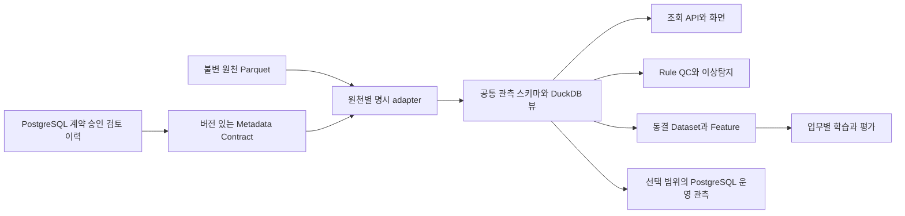

# 40. 공통 관측 스키마 구조 검토

검토일: 2026-10-13. Parquet + DuckDB + Metadata Contract 구조로 통일하는 것은 가능하며, 현재 저장소에는 그 기반인 공통 조회 뷰가 이미 있다. 다만 모든 원천 파일과 조회·QC·학습이 하나의 버전 있는 계약을 사용하는 상태는 아니다. 공통 **조회 열**, 공통 **물리 파일 스키마**, 공통 **의미·처리 계약**은 각각 다른 완료 조건이다.

## 실제로 확인한 현재 구조

검토 대상은 제공 중인 `validation-20261006T134056Z` DuckDB 카탈로그, 추가 월별 Parquet 99개 footer, PostgreSQL 운영 테이블 및 아래 연결 코드다. Footer 검사는 스키마 확인이며 전체 99개 파일의 데이터 행을 새로 해시·대조했다는 뜻은 아니다.

| 구분 | 확인 결과 | 공통화 수준 |
|---|---|---|
| 추가 월별 원천 Parquet | GR_OBS_ST, GD_OBS_BU, GD_OBS_VBU 각각 33개. 물리 열 구성이 3종이며 원천 열은 모두 문자열 | 원천별 보존 형식 |
| SQL*Plus 월별 Parquet | 카탈로그에 GD_OBS_ST_MONTHLY 6,149개 등록. 대표 파일은 station_raw/item_raw/time_raw/value_raw/QC literal/record_class 구조 | 추가 월별 형식과 다름 |
| DuckDB `observations` | 4개 원천별 뷰를 UNION ALL한 15개 공통 필드 | 공통 원문 조회층 있음 |
| DuckDB `observations_with_validation` | source_assets와 monthly_validation을 파일 경로 및 source/station/item/typed depth/month로 결합 | 파일 계보·채널월 검토 정보 결합 있음 |
| PostgreSQL `lake_serving` | snapshot/source_asset/channel_month에 카탈로그·증거 저장. 관측값은 Parquet에서 조회 | 파일 값과 메타데이터 연결 있음 |
| Source Contract 및 Binding | source_contract_v2와 승인 receipt/행 binding 모델·검증 구현 있음 | 계약 저장·검증 기반 있음 |
| API·QC·학습 | 서비스마다 원천 열 선택 및 normalized 뷰를 별도 구현 | 전체 기능의 단일 계약 미완성 |

기존 `observations` 필드는 source_group, station_code, item_code, depth_step/from/to, observed_time_raw, observed_at_source, value_raw, received_time_raw, source_qc/mq/n1 literal, filename, file_row_number다. `observed_at_source`는 timezone 없는 TIMESTAMP이며 명시적 UTC instant가 아니다.

`observations_with_validation`의 physical_sensor_id, standard_unit, timezone_name은 해당 snapshot에서 NULL 추론 결과 **INTEGER**로 보인다. 단순히 같은 열 이름을 제공하는 것만으로 안정된 의미·타입 스키마가 된 것은 아니다. 이후 값이 채워질 때 VARCHAR/TIMESTAMPTZ 등 명시적 타입과 판본을 먼저 정해야 한다.

## 아직 하나로 연결되지 않은 부분

| 연결 지점 | 현재 코드 | 필요한 변경 |
|---|---|---|
| 시계열 조회 | [lake_browser.py](../ocean-ai-platform/backend/app/services/lake_browser.py) | 원천별 열 선택을 공통 adapter/repository로 이동 |
| 동일 기준시각 조회 | [observation_asof.py](../ocean-ai-platform/backend/app/services/observation_asof.py) | 공통 시계·cutoff·수심·가용 시각 계약 사용 |
| 월별 지표 | [native_month_metrics.py](../ocean-ai-platform/backend/app/services/native_month_metrics.py) | 공통 스키마로 source/channel/month 분모 정산 |
| QC 원문·후보 | [qc_workspace.py](../ocean-ai-platform/backend/app/services/qc_workspace.py), [qc_candidate_review.py](../ocean-ai-platform/backend/app/services/qc_candidate_review.py) | 원문 QC, Rule 결과, 검토 확정값의 역할을 공통 contract 상태로 연결 |
| 운영 관측 API | [routes_observations.py](../ocean-ai-platform/backend/app/api/routes_observations.py) | PostgreSQL 전용 ORM 응답과 파일 조회 응답을 버전 있는 공통 DTO로 제공 |
| 학습 입력 | [raw_next_row_training.py](../ocean-ai-platform/backend/app/services/raw_next_row_training.py) | 현재 GR 8열 및 AIR_PRES/WATER_TEMP/SALINITY 전용 경로를 공통 repository 기반으로 확장 |
| 승인·snapshot | [source_contract_authority.py](../ocean-ai-platform/backend/app/services/source_contract_authority.py), [source_contract_snapshot.py](../ocean-ai-platform/backend/app/services/source_contract_snapshot.py) | source/transform/QC/availability/split 판본을 함께 동결 |
| 화면 | FoundationLake, ObservationStatus, QC 및 AI 작업 화면 | 같은 source/channel/cutoff/schema/contract ID를 요청·표시 |

기존 `build_datalake.py`의 이름 추정·첫 수치 열 선택·기본 timezone 적용 normalize는 새 표준 계약의 공용 adapter로 바로 채택하지 않는다. 검증된 원천별 열 대응을 명시해야 한다. 공통 뷰는 원천을 UNION ALL하고 있으므로 서로 다른 원천의 같은 관측을 자동으로 유일 관측 1건으로 정산한 구조도 아니다.

## 권장 목표 구조

대용량 이력의 기준 저장소는 Parquet로 유지하고, DuckDB는 검증된 파일을 공통 스키마로 조회한다. PostgreSQL은 계약·승인·QC 결과·검토·모델 registry와 필요한 운영 조회 범위를 맡는다. 모든 과거 관측을 세 저장소에 복제하는 것이 공통 스키마의 필수 조건은 아니다. Parquet를 직접 조회하는 DuckDB 뷰와 열 이름 병합은 공식 기능이다. 다만 의미·단위·시계의 계약 검증은 별도 구현이 필요하다. [DuckDB Parquet 조회 문서](https://duckdb.org/docs/current/data/parquet/overview)

| 필드군 | 공통 스키마에서 정할 내용 |
|---|---|
| 판본과 계보 | schema_version, adapter_version, contract_id, contract_sha256, asset_id, parquet_sha256, source_row_locator |
| 식별자 | 원천 station/item literal, canonical station/item, logical channel ID, 확인된 physical sensor/episode |
| 시각 | 원문 관측·수신 시각, native timezone 및 해석 상태, offset 명시 observed_at_utc/received_at_utc/available_at/bound_at_utc |
| 관측량 | value_literal, nullable typed value, quantity_kind, source/standard unit, scale/offset/datum, 변환 근거 |
| 공간·수층 | source·역할별 geometry/coordinate frame, 값과 타입을 보존한 depth step/from/to, profile layout |
| 품질 | 모든 원문 QC 단계, codebook/version/effective interval, 별도 Rule·AI 결과, 최종 검토 결정 |
| 상태 | RAW_PRESERVED, SYSTEM_MAPPED, SEMANTICS_VERIFIED, QC_REVIEWED, TRAINING_ELIGIBLE 등 독립 상태 |
| 출처 구분 | ACTUAL/SAMPLE, 원천별 중복/대표 source 정책, observation role |

이름 없는 NULL도 명시한 Arrow/Pydantic/SQL 타입으로 선언한다. 공통 식별자는 원문 파일 SHA와 행 locator를 포함해 안정적으로 생성하고, 소스·수층·원천 literal을 잃는 합성 자연키 하나만으로 병합하지 않는다. 풍향·유향은 원형량, 파주기는 시간량, 파고는 길이량으로 구분한다. vector/profile은 대표 scalar로 강제 축약하지 않는다.

Metadata Contract에는 자동 처리 가능 조건과 사용 범위도 포함해야 한다. 매핑 가능한 source/schema/code, 단위·배율·시계 정책, 유효기간, 근거 SHA, 처리 정책 판본, 예외 격리 규칙, 철회 상태와 현재 허용 용도를 기록한다. 행별 사람 승인 대신 파일·원천·채널·유효기간 단위의 검증된 정책을 적용하고, 충돌·미매핑 건만 검토 대상으로 남길 수 있다.

## 현재 자동 매핑 작업과의 관계

앞선 요청에 따라 [공유 표준 매핑](../ocean-ai-platform/backend/app/services/observation_mapping.py), [시스템 계약·Binding 서비스](../ocean-ai-platform/backend/app/services/source_auto_mapping.py), [재실행 가능한 운영 적재 CLI](../ocean-ai-platform/backend/app/scripts/ingest_operational_parquet.py)를 구현했다. 이는 공통 **운영 매핑 정책**을 묶는 첫 단계다. 기존 모든 Parquet을 새 물리 스키마로 변환하거나 위 API/QC/학습 경로 전체를 공통 DTO로 전환한 구현은 아니다.

자동 계약은 `OPERATIONAL_STANDARDIZATION_ONLY`이며 승인 주체는 `system:source-standard-mapping`이다. 변수·단위·KST 시계는 명시한 시스템 정책을 채택한다. 확인되지 않은 실제 sensor episode·QC 판본을 승인된 원천 사실로 만들어 넣지 않는다. 기존 전체 source authority와 dataset 동결 경로는 이 제한된 receipt를 학습 승인으로 받지 않는다. 실제 적재 범위·건수·검증은 [운영 자동 적재 기록](41_OPERATIONAL_AUTO_MAPPING.md)을 따른다.

## 전환 순서와 완료 판정

1. 공통 observation DTO, Arrow schema, SQL 타입, Metadata Contract를 하나의 판본으로 정의한다. 현재 4개 원천 형식과 reconciled 과거 형식의 대응표를 고정한다.
2. 불변 raw 파일 위에 contract별 공통 DuckDB 뷰를 제공한다. 이후 필요할 때만 canonical Parquet을 별도 판본으로 materialize한다.
3. 관측 조회·기준시각·월별 지표를 같은 repository로 전환하고 실제 원문·분모·수층·cutoff를 대조한다.
4. Rule QC·anomaly/drift·시공간 분석·Feature와 Dataset을 공통 DTO로 연결한다. source availability와 시간 분할 누수를 검증한다.
5. 운영 Raw/Standard 호환 API, UI 필터, 학습 worker, registry·serving, 보고서 링크를 교체한다. 기존 응답은 호환 기간 동안 유지한다.
6. source/item/depth/month별 행 정산, 단위 변환, NULL/공백 QC, clock, 중복·철회·재실행, 실제/샘플 격리, API·화면·학습 동일 입력을 검사한 뒤 새 snapshot을 발행한다.

현재 DuckDB는 1.5.6이다. 기존 파일 카탈로그는 read-only로 제공하고 배치가 새 snapshot을 만든 뒤 검증된 버전을 발행하는 구조를 유지하는 것이 적합하다. 다중 API·agent 프로세스가 같은 내장 DuckDB 파일에 직접 쓰도록 확대하지 않는다. 다중 사용자 업무 원장은 PostgreSQL을 사용한다. [DuckDB 동시성 문서](https://duckdb.org/docs/current/connect/concurrency)

Parquet의 파일·logical type metadata는 저장 형식에 대한 정보다. 이를 해양 업무의 단위·기준면·QC·장비 시행기간을 검증하는 Metadata Contract와 같은 것으로 취급하지 않는다. [Parquet metadata](https://parquet.apache.org/docs/file-format/metadata/), [Parquet logical types](https://parquet.apache.org/docs/file-format/types/logicaltypes/)

최종 판단: **기존 공통 조회 뷰를 확장하는 방향이 적합하다. 새 계약에 맞춰 전체 consumer를 연결하는 작업은 남아 있으며, 전면 공통 스키마 전환 완료로 표시할 수 없다.**
