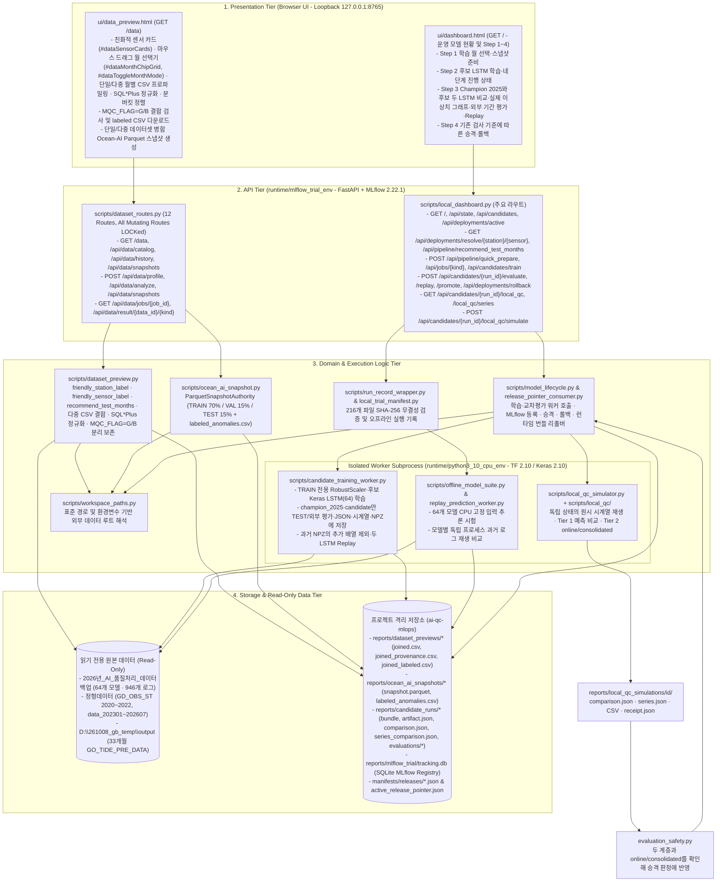

> **상위 통합 문서**: [42. 조위 AI-QC MLOps 엔진 통합 및 5대 연동 브리지](../42_AI_QC_MLOPS_ENGINE_INTEGRATION.md)  
> **문서 세트 목차**: [00 개요](00_OVERVIEW_AND_INDEX.md) · [01 아키텍처·1:1 비교](01_ARCHITECTURE_AND_FEATURES.md) · [02 웹 운영 가이드](02_USER_WEB_OPERATION_GUIDE.md) · [03 Local QC·임계값 평가](03_LOCAL_QC_SIMULATOR_AND_EVALUATION.md) · [04 한계·상용화 로드맵](04_LIMITATIONS_AND_PRODUCTION_ROADMAP.md) · [05 MLOps 거버넌스](05_MLOPS_GOVERNANCE_AND_POLICY.md)

---

# AI 품질처리 MLOps 로컬 시험실 (`ai-qc-mlops`) 기술 문서 인덱스

2026-10-20부터 현재 후보 학습·평가·재현·조회·화면의 비교 대상은 동결된 Champion 2025(`champion_2025`)와 신규 후보(`candidate`) 두 LSTM이다. 학습 표시는 전처리·Scaler → LSTM 학습 → 두 모델 평가·임계값 탐색 → Replay·MLflow 등록의 네 단계다. 과거 네 모델 JSON·시계열·NPZ의 추가 키와 배열은 원본을 보존한 채 읽기 단계에서 제외하며, 과거 `ridge_fit`은 전처리로 표시한다. 현재 번들 재평가·재현에는 Ridge 파일이 필요하지 않고 MLflow에도 두 모델의 비교만 새로 등록한다. 학습·임계값·승격 기준과 실제 운영 상태는 이번 전환으로 바뀌지 않는다. 상세 변경과 검증은 [01 문서](01_ARCHITECTURE_AND_FEATURES.md)를 따른다.

다음 Local QC Simulator 설명과 37개 시험 결과는 이번 1:1 전환 전의 2026-10-20 검증 기록이다. Local QC Simulator의 6단계 구현, Tier 1·Tier 2 online/consolidated 구분, Step 6의 UI·API·승격 검사 연결과 7개 벤치마크는 [03 문서](03_LOCAL_QC_SIMULATOR_AND_EVALUATION.md)를 따른다. 2026-10-20 지정된 두 테스트 모듈은 제어 환경에서 37개 중 36개 통과·1개 건너뜀, CPU 환경에서 37개 모두 통과했다. 기존 소스·결과를 보존하고 테스트와 문서를 마무리했다.

이전 v2의 동작·사용법 및 2026-10-19 실제 학습 9회와 고정 입력창 비교 기록도 본 문서 세트(`01~04`)에 통합되어 있다. 아래 과거 API 수·화면 설명·검증 수치는 해당 날짜의 기록으로 구분하고, 현재 QC 재생 결과를 이전 학습 평가와 섞지 않는다.

작성·갱신일: 2026-10-22 
저장소 표준 경로: `ocean-ai-platform/mlops-qc-engine`  
상위 통합 명세서: [../42_AI_QC_MLOPS_ENGINE_INTEGRATION.md](../42_AI_QC_MLOPS_ENGINE_INTEGRATION.md)  
기준 명세서: `00_OVERVIEW_AND_INDEX.md`

---

## 1. 문서 구성 (목차)

본 `docs/ml-ops-docs/` 폴더는 소스코드 실체(Ground Truth)와 실제 실행 산출물(JSON 매니페스트, Parquet 스냅샷, 모델 번들, SQLite/PostgreSQL 레지스트리)을 교차 검증하여 작성한 **4계층(`UI -> API -> Logic -> DB/Storage`) 기술 문서 세트**입니다.

| 문서 번호 | 문서 파일 | 주요 내용 요약 |
| :--- | :--- | :--- |
| **42 (Platform Bridge)** | [../42_AI_QC_MLOPS_ENGINE_INTEGRATION.md](../42_AI_QC_MLOPS_ENGINE_INTEGRATION.md) | `Ocean-AI` ↔ `mlops-qc-engine` 5대 연동 브리지(`qc_mlops_bridge.py`), 클린 환경 실행 절차(`8000` / `5173` / `8765`), Clean Core 보존 범위(45개 파일) |
| **00 (Index)** | [00_OVERVIEW_AND_INDEX.md](00_OVERVIEW_AND_INDEX.md) | 전체 문서 인덱스, 프로젝트 배경·목적·6대 보호 원칙, 시스템 전체 4계층 아키텍처 다이어그램, Phase 1 ~ Step 4 핵심 현황 요약 |
| **01 (Architecture & Duel)** | [01_ARCHITECTURE_AND_FEATURES.md](01_ARCHITECTURE_AND_FEATURES.md) | 디렉터리 구조, 이중 Python 가상환경 분리 이유, 경로 해석기([workspace_paths.py](../../ocean-ai-platform/mlops-qc-engine/scripts/workspace_paths.py)), HTTP API 엔드포인트 4계층 추적표, 코어 스크립트 명세 및 `champion_2025` vs `candidate` 1:1 LSTM 대결 구조(`champion-candidate-1`) |
| **02 (User Guide)** | [02_USER_WEB_OPERATION_GUIDE.md](02_USER_WEB_OPERATION_GUIDE.md) | 로컬 웹 서버(`127.0.0.1:8765`) 원클릭·CLI 실행 방법, `/data` ([data_preview.html](../../ocean-ai-platform/mlops-qc-engine/ui/data_preview.html)) 및 `/` ([dashboard.html](../../ocean-ai-platform/mlops-qc-engine/ui/dashboard.html)) 화면의 Step 1 ~ Step 4 위저드, 드래그 월 선택기, 테스트 추천 달, 이상치 그래프 조작 가이드 |
| **03 (Local QC & DEV)** | [03_LOCAL_QC_SIMULATOR_AND_EVALUATION.md](03_LOCAL_QC_SIMULATOR_AND_EVALUATION.md) | 로컬 QC 시뮬레이터 6단계 재생기, 운영 호환 `Thres.forecast.DEV` 임계값 역산 인코딩, Tier 1 정상 예측 주 지표 및 Tier 2(`online`/`consolidated`) 비악화 승격 게이트, 7개 벤치마크 검증 결과 |
| **04 (Limitations & Roadmap)** | [04_LIMITATIONS_AND_PRODUCTION_ROADMAP.md](04_LIMITATIONS_AND_PRODUCTION_ROADMAP.md) | 코드·아키텍처 한계점 해소 현황(`LOCK` 직렬화, 다중 파일/데이터셋 UI, 환경변수 데이터 루트, `release_pointer_consumer.py`), 회귀·분류 평가 분석, 레거시 코드 잠재 결함, 실제 운영 서버(Production) 단계별 적용 로드맵 |
| **05 (Governance & Policy)** | [05_MLOPS_GOVERNANCE_AND_POLICY.md](05_MLOPS_GOVERNANCE_AND_POLICY.md) | 7대 MLOps 운영기준 결정안(데이터 버전 고정, MLflow 추적 규격, `candidate`/`champion`/`rollback` 별칭 정책, 정기·조건 기반 재학습, 해역별 불변 release manifest 및 운영 감시 기준) |

---

## 2. 프로젝트 배경 · 목적 · 6대 보호 원칙

### 2.1 배경 및 목적
해양수산부 국립해양조사원(KHOA) 관할해역 조위관측소(49개 관측소, 64개 조위 센서 조합)의 AI 이상치 품질처리(AI QC) 운영 체계는 2025년 기준선 모델(`residual_lstm_forecast.h5`, `scaler.forecast.gz`, `Thres.forecast.DEV`)과 해역별 추론 스크립트(`AI_QC_{east,west,south}_sea_no_update.py`)로 구성되어 있습니다.

본 프로젝트(`ai-qc-mlops`)의 목적은 **기존 운영 AI 소스와 백업 원본 데이터를 1바이트도 수정하지 않고**, 로컬 격리 환경에서 다음 전 주기를 검증·기록하는 것입니다:
1. 운영 반입 자료(16,239개 파일) 및 33개월치 신규 DB 반출 예측조위(`GO_TIDE_PRE_DATA_202401~202609.csv`, 약 10.47GB) 무결성 검증
2. SQL*Plus 축약 헤더 정규화(`sqlplus_gd_obs_st`), 분 단위 시각 정렬(`minute_floor` + `source_obs_timestamp` 보존), `MQC_FLAG == 'B'`(이상치 정답 라벨) 분리 보존(`joined_labeled.csv`, `labeled_anomalies.csv`), `Ocean-AI` (`event-evidence-dataset-2`) 규격의 불변 Parquet 스냅샷 생성
3. 격리 TensorFlow 워커 기반 후보 LSTM 학습 및 동일 `TEST` 구간 또는 외부 기간 스냅샷(`eval_snapshot_id`)에서 Champion 2025와 후보의 회귀 오차(`MAE`, `RMSE`)·실제 이상치 분류(`F1-Score`, `Precision`, `Recall`, `TP/FP/TN/FN`) 비교와 `replay=True` 재현 검사. 365일·524,845행 학습은 아래 과거 검증 기록으로 구분한다.
4. 로컬 MLflow Registry(`tracking.db`) 별칭(`trial`, `candidate`, `champion`, `rollback`) 전환, 불변 배포 매니페스트(`operational_release_manifest`) 기반 승격·롤백 제어, 및 런타임 활성 번들 리졸버([release_pointer_consumer.py](../../ocean-ai-platform/mlops-qc-engine/scripts/release_pointer_consumer.py)) 검증

### 2.2 6대 보호 원칙 (Protection Rules)
`00_OVERVIEW_AND_INDEX.md`에 정의된 절대 보호 원칙은 모든 코드와 테스트에서 강제됩니다:
1. **원본 읽기 전용 보존**: `2026년_AI_품질처리_데이터백업` 아래 원본(16,239개 파일, 핵심 216/311개 SHA-256 해시)은 읽기 전용 기준 자료로 취급하며 절대 수정하지 않습니다.
2. **원본 자산 이동·개명 금지**: 기존 모델(`.h5`), 스케일러(`.gz`), 임계값(`.DEV`), 매핑(`mappingBySea.csv`), 환경 아카이브(`python3_10_env.tar.gz`)를 이동·개명·덮어쓰기하지 않습니다.
3. **비밀정보 기록 금지**: 운영 DB 접속정보의 실제 값은 매니페스트, 로그, 보고서, 문서에 기록하지 않으며 정적 스캔 시 `REDACTED` 처리합니다(`scan_legacy_configuration.py`).
4. **운영 DB 무접속 (`operational_database_used: False`)**: 로컬 시험실의 모든 도구는 운영 Oracle DB에 연결하거나 데이터를 갱신하지 않습니다.
5. **품질 플래그 위치 고정 (`ai_flag_position == 11`)**: `N1_AQC_FLAG` 문자열 내 AI 판정 위치는 기존과 동일하게 **11번째 자리**로 고정합니다.
6. **증거 수준 및 실패 정직성 유지**: 로컬 백업 검증(`LOCAL_BACKUP_VERIFIED`)과 실제 운영 서버 해시 확인(`LIVE_RUNTIME_CONFIRMED`)을 엄격히 구분하며, 오프라인 재생 비교의 기준 초과(5개 모델 `MISMATCH`)나 중단된 실행을 임의로 성공(`PASS`)으로 위장하지 않습니다.

---

## 3. 시스템 아키텍처 다이어그램 (4계층 + 이중 런타임 구조)

---

## 4. Phase 1 ~ Step 4 및 한계점 해소 핵심 현황 요약

| 단계 | 핵심 구현 및 검증 내용 | 핵심 근거 파일 및 정량 지표 |
| :--- | :--- | :--- |
| **Phase 1 (기초 자산 조사 및 격리 복원)** | - 49개 관측소·64개 센서 운영 모델(필수 산출물 192개, 전체 검증 대상 216개) SHA-256 기준선 매니페스트 확정 - 94개 학습 보관 폴더 분류(운영 64, 비운영 보관 23, 데이터 부족 7) - `python3_10_env.tar.gz`를 `runtime/python3_10_env_restored`에 격리 복원 및 CPU 추론 검증 - 레거시 Python 9개 파일 정적 스캔(비밀정보 Redaction) 및 7대 MLOps 거버넌스 수립 | - [2025_operation_64_manifest.json](../../ocean-ai-platform/mlops-qc-engine/manifests/2025_operation_64_manifest.json) - [20261006_local_trial_manifest.json](../../ocean-ai-platform/mlops-qc-engine/manifests/20261006_local_trial_manifest.json) - [2025_training_archive_inventory.json](../../ocean-ai-platform/mlops-qc-engine/manifests/2025_training_archive_inventory.json) - `legacy_configuration_inventory.json` - [MLOps_운영기준_결정안.md](05_MLOPS_GOVERNANCE_AND_POLICY.md) |
| **로컬 시험실 및 오프라인 재생 검증** | - 64개 모델 전체 CPU 로딩 및 고정 입력 반복 예측 **64/64 PASS** - 과거 상세 로그(946개 파일) 중 정상 연속 4분 입력창 재생 비교(`20261007T004328Z_fb946b3984`): 비교 가능 **60개 모델(1,140개 시점) 중 55개 PASS(`<= 0.01 cm`), 5개 MISMATCH(`> 0.01 cm`), 4개 `NO_ELIGIBLE_NORMAL_WINDOWS`(전 구간 결측 flag `9`)** - Windows `0xC0000005` 네이티브 크래시 방지를 위한 모델별 서브프로세스 격리([replay_prediction_worker.py](../../ocean-ai-platform/mlops-qc-engine/scripts/replay_prediction_worker.py)) | - [offline_model_suite.py](../../ocean-ai-platform/mlops-qc-engine/scripts/offline_model_suite.py) - [replay_prediction_worker.py](../../ocean-ai-platform/mlops-qc-engine/scripts/replay_prediction_worker.py) - [register_mlflow_trial.py](../../ocean-ai-platform/mlops-qc-engine/scripts/register_mlflow_trial.py) |
| **Step 1 (Depth 1 현황판 · 마우스 드래그 월 선택기 · 데이터 정규화 · MQC_FLAG=B 보존 · Ocean-AI 스냅샷)** | - `D:\261008_gb_temp\output` 33개월 예측조위(`GO_TIDE_PRE_DATA_202401~202609.csv`, 약 10.47GB) 및 2023~2026 마우스 클릭-앤-드래그 연·월 CSV 선택기(`#quickMonthGrid`, `#dataMonthChipGrid`, `selected_yms`), 미학습/이상치 최다 테스트 달 추천(`GET /api/pipeline/recommend_test_months`) 연결 - SQL*Plus `GD_OBS_ST` 7컬럼 절단 헤더 정규화(`sqlplus_gd_obs_st`), 분 단위 버킷 정렬(`minute_floor` + `joined_provenance.csv` 보존), `MQC_FLAG == 'B'` 이상치 라벨 보존(`joined_labeled.csv`, `labeled_anomalies.csv`) - 단일/다중 데이터셋 병합 및 원클릭(`POST /api/pipeline/quick_prepare`) `Ocean-AI` (`event-evidence-dataset-2`) Parquet 스냅샷 생성 | - [dataset_preview.py](../../ocean-ai-platform/mlops-qc-engine/scripts/dataset_preview.py) - [ocean_ai_snapshot.py](../../ocean-ai-platform/mlops-qc-engine/scripts/ocean_ai_snapshot.py) - 스냅샷 `20261016T100944_5f81cca7` (2025년 1년 전체 묵호 `DT_0006 / TIDE_LEVEL_LASER`, 524,845행) & `20261016T115153_82ef6d9d` (2026-01 묵호, 44,637행) - 스냅샷 `20261015T175043_97b6c59a` (2024-01 흑산도 `DT_0035 / TIDE_LEVEL_LASER_1`, 정상 39,855행 + 이상치 `'B'` 4,778행) |
| **Step 2 & Step 3 (현재 두 LSTM 비교 / 과거 실행 이력 구분)** | `TRAIN` 전용 scaler·후보 LSTM 학습 후 동결된 `champion_2025`와 `candidate`만 TEST·외부 기간 평가, 시계열 표시와 재현 검사에 사용한다. 새 비교 JSON·NPZ·MLflow 결과에도 두 모델만 기록한다. 기존 학습 조건·임계값·승격 기준을 유지한다. | **2026-10-14~16 네 모델 검증 이력:** - [candidate_training_worker.py](../../ocean-ai-platform/mlops-qc-engine/scripts/candidate_training_worker.py) - 실행 `20261016T030628Z_5f28e86e` (묵호 `DT_0006`, 2025년 1년치 524,845행 학습 → 2026년 1월 44,621창 교차 평가): 2026년 `candidate` **F1 `99.37점` (1위, 차트 이상치 60/60 탐지)** vs `champion_2025` **F1 `99.11점` (57/60 탐지, 후보 단독 3건 추가 탐지)** - 실행 `20261015T085043Z_d6695234` (흑산도 `DT_0035`, 실제 `'B'` 3,764창): `champion_2025` & `ridge` **F1 `100.0점`** - 실행 `20261014T084211Z_af81e555` (인천 `DT_0001`): `candidate` MAE **`0.701027 cm`**, **F1 `100.0점`** |
| **Step 4 (승격 · 독립 롤백 · 런타임 번들 리졸버 · 위저드 UI)** | - 후보 모델 승격(`candidate -> champion`), 독립 대상 롤백(`rollback -> champion`), `operational_release_manifest` 및 [active_release_pointer.json](../../ocean-ai-platform/mlops-qc-engine/manifests/active_release_pointer.json) 갱신 - 레거시 소스 무수정 배포 어댑터 [release_pointer_consumer.py](../../ocean-ai-platform/mlops-qc-engine/scripts/release_pointer_consumer.py) (`GET /api/deployments/resolve/{station}/{sensor}`) 및 전 변경 API `LOCK` 동기화 - 양쪽 가상환경에서 **41개 단위·통합 회귀 테스트 전원 통과(`OK`)** | - [model_lifecycle.py](../../ocean-ai-platform/mlops-qc-engine/scripts/model_lifecycle.py) - [release_pointer_consumer.py](../../ocean-ai-platform/mlops-qc-engine/scripts/release_pointer_consumer.py) - `test_ocean_ai_mlops_step1_to_3.py` (41개 전체 테스트 `OK`) |

