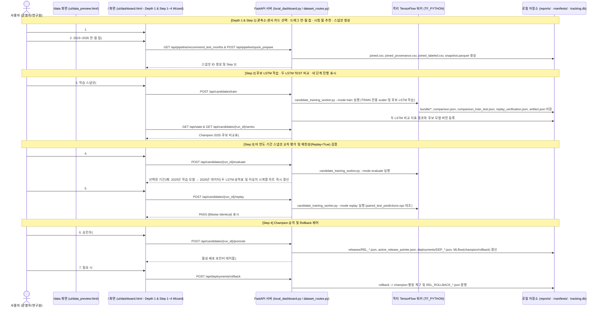

> **상위 통합 문서**: [42. 조위 AI-QC MLOps 엔진 통합 및 5대 연동 브리지](../42_AI_QC_MLOPS_ENGINE_INTEGRATION.md)  
> **문서 세트 목차**: [00 개요](00_OVERVIEW_AND_INDEX.md) · [01 아키텍처·1:1 비교](01_ARCHITECTURE_AND_FEATURES.md) · [02 웹 운영 가이드](02_USER_WEB_OPERATION_GUIDE.md) · [03 Local QC·임계값 평가](03_LOCAL_QC_SIMULATOR_AND_EVALUATION.md) · [04 한계·상용화 로드맵](04_LIMITATIONS_AND_PRODUCTION_ROADMAP.md) · [05 MLOps 거버넌스](05_MLOPS_GOVERNANCE_AND_POLICY.md)

---

# 사용자 웹 조작 가이드 (`02_USER_WEB_OPERATION_GUIDE.md`)

현재 QC 재생기 사용법과 결과 해석은 [03 문서](03_LOCAL_QC_SIMULATOR_AND_EVALUATION.md)를 따른다. 화면 Step 3에서 후보를 선택한 뒤 `2-Tier 로컬 전체 QC 시뮬레이션 비교`의 기록을 고르면 Tier 1 예측, Tier 2 최초 판정(online), 사후 최종 판정(consolidated)을 각각 확인할 수 있다. 준비 관측·원시 결측·최종 GAP와 승격 사유도 함께 표시한다. 실제 B가 없는 결과의 F1·사건 탐지율은 `미검증`이다.

새 실행은 `내부 TEST 구간` 또는 `스냅샷 전체 (ALL)`을 선택하고 `선택 후보로 2-Tier 전체 QC 시뮬레이션 실행`을 누른다. ALL에서는 선택한 평가 snapshot을 사용한다. 현재 화면에 보이는 VALIDATION은 작업기가 지원하지 않으므로 이 실행 범위로 사용하지 않는다. 작업 상태는 별도로 조회하며, 재생 완료가 승격을 뜻하지 않는다. 실행 중인 대시보드는 재시작해야 새 소스를 사용한다.

2026-10-20 현재 학습·평가·표·그래프·정보 카드는 동결된 Champion 2025와 신규 후보 두 LSTM만 비교한다. Step 1은 학습 월 선택, Step 2는 후보 학습, Step 3은 미학습 기간 비교와 실제 B 월별 집계로 나뉜다. 휠 확대·드래그 이동·이벤트 이동은 유지한다. 과거 네 모델 파일도 원본을 바꾸지 않고 두 모델만 표시하며 Ridge 파일 없이 재평가·재현한다. 임계값·Tier 1·Tier 2 기준과 실제 운영 상태는 바꾸지 않는다. [01 문서](01_ARCHITECTURE_AND_FEATURES.md)에 변경 범위를 기록한다. 아래 Depth 1·이전 선택기 설명은 2026-10-16 이전 화면 기록이며 현재 Step 2·3 조작법은 4.2·4.3절을 따른다.

작성·갱신일: 2026-10-22<br>
관련 인덱스: [00_OVERVIEW_AND_INDEX.md](00_OVERVIEW_AND_INDEX.md)

---

## 0. 간단히 보기와 새 화면 안내

대시보드와 `/data`는 **간단히 보기**로 시작한다. 상단 `자세히 보기` 버튼(`#easyModeToggle`)을 누르면 파일 경로·학습 숫자·전문 지표의 설명을 더 볼 수 있다. 다시 간단히 보기로 돌아와도 선택한 대상, 입력값, 진행 상태와 오류는 유지된다. 접힌 영역은 제목을 눌러 개별적으로 열 수도 있다. 실패 이유, 실제 이상치가 없어 성능을 확인하지 못했다는 안내, 평가 기간 불일치와 모델 변경이 막힌 이유는 간단히 보기에서도 확인할 수 있다.

주요 흐름은 **자료 고르기 → 새 모델 만들기 → 결과 비교 → 모델 바꾸기·되돌리기**이다. 상단 진행 막대는 현재 화면 위치를 나타내며, 실제 작업 완료율은 작업별 진행 카드에서 확인한다. 해역과 단계는 서로 다른 색으로 구분하고, 검사 통과·실패는 색뿐 아니라 상태 문구로도 표시한다. 기기의 모션 감소 설정을 켜면 이동 효과도 줄어든다.

화면의 **2025 기준 모델**은 고정된 `champion_2025`이며 자세한 표의 `Champion 2025`와 같은 모델이다. **현재 사용하도록 지정된 모델**은 실제 활성 포인터의 모델이므로 기준 모델과 다를 수 있다. **새로 학습한 모델**은 기존의 `신규 후보`를 뜻한다. `학습 자료 묶음`의 실제 저장 형식은 Parquet 스냅샷이며, `같은 조건으로 다시 실행해 확인`은 기존 Replay 검증을 뜻한다. 이번 변경은 화면 표시와 조작 안내에 한정하며 학습·검사·모델 변경 기준을 바꾸지 않는다.

| 새 조작 | 사용 방법과 의미 |
| :--- | :--- |
| 계절 분포 (`#quickSeasonBalanceBar`, `#dataSeasonBalanceBar`) | 선택 월을 봄·여름·가을·겨울로 나누어 보여준다. 계절 칩을 누르면 해당 월 카드로 이동하며 선택은 바뀌지 않는다. 여러 해의 같은 달은 별도 월로 센다. 네 계절을 선택해도 자료량이 균등하거나 검증이 끝났다는 뜻은 아니다. |
| 학습 설정 바로가기 (`#trainingPresetCards`) | 짧게 5회·기본 30회·길게 50회 중 고르면 배치 64·시드 42와 함께 입력된다. 학습은 시작 버튼을 눌러야 실행된다. 숫자를 직접 바꾸면 `직접 설정`으로 표시하며, 반복 횟수가 많다고 더 정확하다는 뜻은 아니다. |
| 선택과 결과 구분 (`#selectionVsResultStrip`) | 지금 고른 대상과 화면에 표시한 결과의 후보·기간을 따로 확인한다. 선택을 바꾸어 이전 결과가 무효가 되면 다시 비교하기 전까지 과거 점수를 새 결과처럼 표시하지 않는다. |
| 파일 짝 요약 (`#dataFilePairSummary`) | 고른 월 수와 실제 경로 목록에서 관측·예측이 함께 있는 월 수를 따로 표시한다. 누르면 파일 경로 영역을 열어 확인할 수 있다. 파일 존재나 내용 검사를 대신하지 않는다. |
| 결과에서 근거로 이동 | 오탐·미탐·끊긴 구간 등의 근거 보기 버튼을 누르면 관련 표나 그래프를 펼치고 해당 위치로 이동한다. 이 조작만으로 새 검사나 학습을 실행하지 않는다. |

### 2023년 자료와 표준 학습자료 경로

월별 관측 자료는 `정형데이터/GD_OBS_ST/GD_OBS_ST_YYYYMM.csv`, 예측 자료는 `정형데이터/GO_TIDE_PRE_DATA/GO_TIDE_PRE_DATA_YYYYMM.csv`에서 고른다. 2023년 예측 12개월도 연결하여 2023-01~2026-07의 관측·예측 짝을 선택할 수 있다. 예측만 있는 2026년 8~9월은 관측 자료를 확보하기 전까지 학습용 짝으로 표시하지 않는다. 두 화면의 `2023년 전체` 버튼과 월 카드로 선택하며, 파일이 여러 곳에 있어도 로컬 표준 폴더의 같은 월 파일을 먼저 사용한다.

새 월별 파일은 첫 줄에 정식 컬럼명이 있고 SQL*Plus의 반복 헤더·구분선이 없다. 기존 이력의 `data_YYYYMM.csv` 경로와 시험용 레거시 파일도 계속 읽을 수 있으므로 사용자가 과거 기록을 일괄 수정할 필요는 없다. 정식 헤더는 `strict`와 `sqlplus_gd_obs_st` 두 옵션에서 모두 읽을 수 있다. 헤더를 정리해도 원래 초 단위 관측 시각은 남으므로 월별 빠른 준비는 기본 분 단위 정렬을 유지하며, 직접 지정한 시각 정렬 옵션은 그대로 적용한다.

자료 경로가 C:에 있어도 연결 대상이 Z:이면 열기 전에 거부한다. 연결이 순환하거나 대상을 확인할 수 없는 경우에도 오류를 표시하므로 자료 경로 설정을 확인한다. 안전한 C: 연결과 하드링크, 기존 D: 예측 자료 경로는 계속 사용할 수 있다.

D:의 두 예측 원본과 보호 백업 폴더는 변경하지 않는다. 2020~2022 다년도 파일은 원래 위치에 남고 표준 폴더의 하드링크에서도 같은 자료를 읽는다. 변환·검증·기존 월별 파일 삭제 기록은 `reports/20261021_data_standardization/standardization_manifest.json`에서 확인할 수 있다. 이번 변경은 로컬 학습자료와 화면 연결이며 모델 변경이나 운영 DB 적용을 실행하는 기능은 아니다.

실제 표준 자료 90개와 여섯 관측소·센서 조합의 43개월 집계가 준비되어 있다. 카탈로그에는 보존한 D: 원본도 계속 표시되지만 자동 선택에서는 C: 표준 자료를 우선한다. 월별 파일이 있다고 해서 선택한 모든 센서에 학습 가능한 관측값이 있다는 뜻은 아니다. 예를 들어 2023년 1월 `DT_0001`에는 `TIDE_LEVEL_LASER_1`의 G/B 기록이 있으며 `TIDE_LEVEL_LASER`의 집계는 G/B 모두 0이다. 자료가 없는 센서를 다른 센서로 자동 바꾸지 않으므로 선택한 관측소와 센서도 함께 확인한다.

## 1. 로컬 웹 서버 실행 및 접속 방법

로컬 시험실 웹 서버는 외부 네트워크 노출을 차단하기 위해 **루프백 주소(`http://127.0.0.1:8765`)에서만 동작**하며, 다음 두 가지 방법 중 하나로 실행합니다.

### 방법 A: `Ocean-AI` MLOps 웹 화면에서 원클릭 기동 (권장)
1. `Ocean-AI` 백엔드(`8000`) 및 프론트엔드(`5173`)를 실행한 뒤 브라우저에서 `http://127.0.0.1:5173/mlops` ([MLOps.tsx](../../ocean-ai-platform/frontend/src/pages/MLOps.tsx))에 접속합니다.
2. 상단 **조위 AI-QC 학습·승격 워크벤치 (ai-qc-mlops 5대 연동)** 카드에서 **`8765 워크벤치 서버 기동`** 버튼을 클릭합니다(`POST /api/mlops/qc-engine/start`).
3. 백엔드([qc_mlops_bridge.py](../../ocean-ai-platform/backend/app/services/qc_mlops_bridge.py))가 `http://127.0.0.1:8765/api/state` 응답(`application_id == "oceandb-local-trial-dashboard"`)을 확인하여, 서버가 꺼져 있으면 백그라운드로 [scripts/local_dashboard.py](../../ocean-ai-platform/mlops-qc-engine/scripts/local_dashboard.py)를 기동(`reports/dashboard_stdout.log`, `reports/dashboard_stderr.log` 기록)한 뒤 임베디드 워크벤치 화면(Iframe)을 자동으로 새로고침합니다.

### 방법 B: 터미널(CLI)에서 직접 포그라운드 실행
```powershell
python ocean-ai-platform/mlops-qc-engine/scripts/local_dashboard.py --host 127.0.0.1 --port 8765 --no-browser
```
기동 후 브라우저에서 다음 두 화면을 조작할 수 있습니다:
- **메인 대시보드 화면 (`/`)**: `http://127.0.0.1:8765/` ([ui/dashboard.html](../../ocean-ai-platform/mlops-qc-engine/ui/dashboard.html)) — 상단 **Depth 1 64개 운영 모델 현황 패널(`#depth1OperatingPanel`, `#operatingStationCards`)** 및 **Step 1 ➔ Step 2 ➔ Step 3 ➔ Step 4 ➔ Legacy ➔ 전체 보기** 단계별 위저드(`#wizardStepper`) 제공
- **학습자료 및 스냅샷 생성 화면 (`/data`)**: `http://127.0.0.1:8765/data` ([ui/data_preview.html](../../ocean-ai-platform/mlops-qc-engine/ui/data_preview.html))

---

## 2. 전체 사용자 조작 흐름도 (End-to-End Workflow)



---

## 3. Step 1 화면 조작 상세 가이드: `/data` ([ui/data_preview.html](../../ocean-ai-platform/mlops-qc-engine/ui/data_preview.html))

메인 화면의 **`다중 파일·365일 병합 상세 화면 열기 (/data)`** (`href="/data"`) 버튼을 누르거나 `http://127.0.0.1:8765/data`로 접속합니다.

### 3.1 섹션 1: `1. 자료 및 정규화 옵션 선택` ([data_preview.html](../../ocean-ai-platform/mlops-qc-engine/ui/data_preview.html))

| UI 엘리먼트 ID | 라벨 / 버튼 텍스트 | 선택 옵션 및 실제 동작 |
| :--- | :--- | :--- |
| `#mode` | **자료 종류** | - `paired` (`관측 CSV + 예측조위 CSV`): 관측 CSV와 예측조위 CSV 두 벌을 결합 검사(`#predictionBox` 표시)<br/>- `historical` (`운영 상세 로그 한 벌 · 과거자료 검사`): `debug_logs/debug_log_*.csv` 단일 파일 검사(`#predictionBox` 숨김) |
| `#encoding` | **파일 인코딩** | - `utf-8-sig` (`UTF-8 · 기본`)<br/>- `cp949` (`CP949 · 한글이 깨지는 경우`) |
| `#columnNorm` | **컬럼명 정규화 옵션** | `strict`와 `sqlplus_gd_obs_st` 모두 정식 헤더 또는 정확히 알려진 SQL*Plus GD_OBS_ST 7컬럼 헤더를 자동 인식한다. 기존 반출본의 `OBS_POST_I`, `QC`, `MQ`, `N1_AQC_FLA`는 정식 이름으로 읽고 반복 헤더·점선·`rows selected.`는 제외한다. 모르는 축약 헤더는 임의로 추측하지 않고 오류를 알린다. |
| `#timeAlign` | **관측·예측 시각 정렬 기준** | - `exact_minute` (`기본 · 정각(:00초) 1분 시각만 결합`): 초 단위가 `:00`이 아닌 관측 행은 `invalid_time`으로 제외<br/>- `minute_floor` (`권장 · 분 단위 버킷(:00초) 정규화 및 source_obs_timestamp 원본 보존`): `:48`초 등 비정각 관측 시각을 분 단위(`:00`초)로 내림 정렬하여 예측조위와 결합하되, 원본 시각을 `source_obs_timestamp`에 보존 |
| `#obsFile`, `#obsPath`, `#inspect` | **관측 CSV 또는 상세 로그** / **`파일 형식 확인`** | 드롭다운(`#obsFile`)에서 선택하면 경로 입력창(`#obsPath`)이 자동 채워집니다. `#inspect` (`파일 형식 확인`) 클릭 시 `POST /api/data/profile`을 호출하여 상위 5행과 컬럼 목록, 파일 크기를 `#profile`에 표시합니다. |
| `#prdFile`, `#prdPath`, `#inspectPrediction` | **예측조위 CSV (`D:\261008_gb_temp\output` 포함)** / **`예측 파일 형식 확인`** | `GO_TIDE_PRE_DATA` CSV를 선택하고 `#inspectPrediction` (`예측 파일 형식 확인`)으로 `OBS_POST_ID`, `OBS_TIME`, `TIDE_PRE_VAL` 컬럼 유무를 확인합니다. |
| `#clearMultiPathsBtn` | **`다중 파일 목록 비우기`** | 클릭 시 다중 파일 병합 입력창(`#obsPathsList`, `#prdPathsList`), 단일 파일 경로(`#obsPath`, `#prdPath`) 및 선택된 월 칩 상태를 모두 초기화합니다. |
| `#trainingPair` | **`2020~2022 학습자료 두 벌 선택`** | 클릭 시 `GD_OBS_ST_2020_2022_ALL_DT.csv` + `GO_TIDE_PRE_DATA_2020_2022_ALL_DT.csv`, `paired`, `strict`, `exact_minute`로 자동 설정하고 첫 날짜를 세팅합니다. |
| `#newExportPair` | **`2024년 1월 신규 반출자료(GD_OBS_ST + GO_TIDE_PRE_DATA) 선택`** | 클릭 시 `data_202401.csv` + `GO_TIDE_PRE_DATA_202401.csv`, `paired`, `sqlplus_gd_obs_st`, `minute_floor`, 관측소 `DT_0001`(인천), 센서 `TIDE_LEVEL_VEGA`, 기간 `2024-01-01` ~ `2024-01-31`을 원클릭 자동 설정합니다. |
| `#historicalExample` | **`확보된 실제 과거자료로 먼저 보기`** | 클릭 시 `debug_logs` 첫 파일을 `historical` 모드로 자동 설정합니다. |

### 3.2 섹션 2: `2. 확인할 대상과 기간` · 센서 카드 & 드래그 연·월 칩 선택기 ([data_preview.html](../../ocean-ai-platform/mlops-qc-engine/ui/data_preview.html))
1. **관측소(`#station`)** 및 **센서 카드(`#dataSensorCards`) / 드롭다운(`#sensor`)**: `mappingBySea.csv`의 49개 관측소(`인천 조위관측소 (DT_0001)` 형식)를 선택하면 해당 관측소의 보유 센서 카드(`#dataSensorCards`, `실제 조위 센서: 레이저식 조위계 · 주 센서 (TIDE_LEVEL_LASER)` 등)가 즉시 표시되어 직관적으로 클릭 선택할 수 있습니다.
2. **2023~2026 연·월 클릭·드래그 선택 그리드 (`#dataMonthChipGrid`, `#dataToggleMonthMode`, `#dataSelectedMonthsSummary`) 및 연도 프리셋 (`#dataPreset2024All`, `#dataPreset2025All`, `#dataPreset2026Avail`, `#clearMultiPathsBtn`)**:
   - 마우스 클릭 및 드래그로 연속된 연·월 구간을 직관적으로 선택할 수 있으며, `#dataToggleMonthMode`(`개별 월 추가/해제 모드 (비연속 다중 월 선택)`) 체크박스를 켜거나 `Ctrl+클릭`하면 비연속적인 개별 월을 자유롭게 추가/해제할 수 있습니다.
   - 원하는 연도 프리셋 버튼이나 개별 월 칩(`1월`~`12월`)을 클릭/드래그하면 시작일(`#dateStart`)~종료일(`#dateEnd`)이 자동 계산되고, 선택된 월(`selected_yms`)의 관측 CSV(`data_YYYYMM.csv`) 및 예측조위 CSV(`GO_TIDE_PRE_DATA_YYYYMM.csv`)가 `#obsPathsList`와 `#prdPathsList`에 즉시 자동 매칭됩니다.
3. **시작 날짜(`#dateStart`)** 및 **마지막 날짜(`#dateEnd`)**: 날짜를 지정하면 `#expected` 영역에 선택 일수와 예상 1분 건수(`일수 × 1,440건`)가 즉시 계산됩니다.
4. **`자료 결합·검사 실행` (`#analyze`)**: 클릭하면 `POST /api/data/analyze` 비동기 작업이 시작되며, 1.5초 간격으로 `GET /api/data/jobs/{job_id}`를 폴링하여 읽은 행 수를 `#status`에 실시간 표시합니다.

### 3.3 섹션 3: `3. 실제 검사 결과 및 Ocean-AI 스냅샷 생성` ([data_preview.html](../../ocean-ai-platform/mlops-qc-engine/ui/data_preview.html))
검사가 완료되면 숨겨져 있던 `#result` 패널이 나타납니다:
- **요약 카드 (`#metrics`)**: `예상 1분 건수`, `유효 결합 건수(G)`, `유효율(%)`, `유효량 환산(일)`, `이상치 라벨(B) 건수` 표시.
- **연속성 요약 (`#continuity`)**: 결측 분수, 최장 결측 구간, 연속 구간 수, 최장 연속 구간(분), **4분 입력 + 1분 타깃 연속 학습창 수(`contiguous_4_input_1_target_windows`)** 표시.
- **Ocean-AI 스냅샷 생성 버튼 (`#buildSnapshotBtn`: `이 검사 결과로 Ocean-AI Parquet 스냅샷 생성`)**:
  - 클릭 시 현재 검사된 `currentDatasetId`와 `split_ratios: [0.70, 0.15, 0.15]`로 `POST /api/data/snapshots`를 호출합니다.
- **다운로드 버튼 4종 (`#downloads`)**:
  1. **`결합 CSV 받기`** (`/api/data/result/{dataset_id}/csv` → `joined.csv`)
  2. **`출처 보존 CSV (source_obs_timestamp) 받기`** (`/api/data/result/{dataset_id}/provenance_csv` → `joined_provenance.csv`)
  3. **`MQC 라벨 보존 CSV (G+B 이상치 포함) 받기`** (`/api/data/result/{dataset_id}/labeled_csv` → `joined_labeled.csv`)
  4. **`검사 기록(JSON) 받기`** (`/api/data/result/{dataset_id}/manifest` → `dataset_manifest.json`)

### 3.4 섹션 4: `4. 저장된 검사 기록 · 다중 데이터셋 병합 스냅샷 · Ocean-AI 스냅샷 목록` ([data_preview.html](../../ocean-ai-platform/mlops-qc-engine/ui/data_preview.html))
- **다중 데이터셋(`dataset_ids`) 병합 스냅샷 생성 (`#multiDatasetCheckboxes`, `#datasetMergeRows`, `#mergedSplitRatios`, `#buildMergedSnapshotBtn`)**: 저장된 여러 월별 검사 기록을 체크박스(`.ds-merge-check`)로 선택하고 분할 비율(`#mergedSplitRatios`, 기본 `0.70,0.15,0.15`)을 지정하여 단일 통합 `Ocean-AI` Parquet 스냅샷으로 병합 생성할 수 있습니다.
- **생성된 Ocean-AI (`event-evidence-dataset-2`) 스냅샷 아티팩트 테이블 (`#snapshotRows`)**: 생성된 모든 스냅샷의 `스냅샷 ID`, `원본 Dataset ID`, `관측소 / 센서`, `기간`, `정규화 / 시각정렬` 태그, `정상(G) 행 / 이상치(B) 행`, `TRAIN / VAL / TEST 창`, **`Parquet` · `Manifest` 다운로드 링크**를 제공합니다.

---

## 4. 메인 대시보드 Depth 1 및 Step 1 ~ Step 4 위저드 조작 상세 가이드: `/` ([ui/dashboard.html](../../ocean-ai-platform/mlops-qc-engine/ui/dashboard.html))

메인 대시보드(`/`)는 상단에 **Depth 1: 현재 운영 중인 64개 조위 AI 모델 현황 및 업그레이드 대상 선택 패널(`#depth1OperatingPanel`)**을 제공하며, **단계별 진행 바(`#wizardStepper`: `Step 1: 데이터·스냅샷 준비` ➔ `Step 2: 후보 모델 학습` ➔ `Step 3: Champion 2025·후보 비교·외부 기간 평가` ➔ `Step 4: 승격·롤백·번들 리졸버` ➔ `Legacy: 64개 기준선 시험` ➔ `전체 한눈에 보기`)**와 이전/다음 단계 이동 버튼(`#wizardPrevBtn`, `#wizardNextBtn`)을 통해 한 번에 한 단계씩 집중해서 실행할 수 있습니다.

### 4.0 Depth 1 패널 (`#depth1OperatingPanel`): `현재 운영 중인 64개 조위 AI 모델 현황 및 업그레이드 대상 선택`
- **해역/상태/키워드 필터 (`#seaFilterButtons`, `.sea-pill-btn`, `#operatingStationSearch`, `#operatingSummaryPills`)** 및 **관측소별 운영 모델 카드 그리드 (`#operatingStationCards`)**:
  - 49개 관측소·64개 조위 센서의 현재 운영 상태(`신규 Champion 승격 운영 중` vs `2025 기본 모델 (Baseline)`), 한글 관측소명(`묵호 조위관측소 (DT_0006)`), 한글 센서 설명(`레이저식 조위계 · 주 센서 (TIDE_LEVEL_LASER)`), 보유 스냅샷·후보 모델 수를 한눈에 보여줍니다.
  - 카드 내 센서 버튼을 클릭하면 `selectStationForUpgrade(station, sensor)` 및 `syncStationSensorToStep2And3(station, sensor)`가 동작하여 **Step 1(`#quickStationSelect`, `#quickSensorSelect`), Step 2(`#candSnapshotSelect`, `#candTrainEvalSnapshotSelect`), Step 3(`#candRunSelect`, `#candEvalSnapshotSelect`) 드롭다운이 모두 해당 관측소·센서로 자동 동기화**됩니다.

### 4.1 Step 1 패널 (`data-step-panel="step1"`): `학습·평가 데이터 준비 (드래그 연·월 칩 선택 & 시험 월 추천 & Ocean-AI 스냅샷 원클릭 생성)`
- **관측소(`#quickStationSelect`) · 센서 카드(`#quickSensorCards`) · 이상치 확인 관측소 프리셋(`#btnPresetAnomalyStation`)**:
  - 관측소를 선택하면 해당 관측소에 설치된 실제 조위 센서 카드(`#quickSensorCards`)가 렌더링되며, `#btnPresetAnomalyStation` 클릭 시 실제 KHOA 수동 품질검사 이상치(`MQC_FLAG='B'` 4,778건)가 검증된 `흑산도 조위관측소 (DT_0035)` · `TIDE_LEVEL_LASER_1` · `2024-01`로 즉시 설정됩니다.
- **연·월 클릭·드래그 선택 그리드 (`#quickMonthGrid`, `#quickToggleMonthMode`, `#quickSelectedMonthsSummary`) 및 원클릭 기간 프리셋 (`#quickPreset202401`, `#quickPreset2024All`, `#quickPreset2025All`, `#quickPreset2026Avail`, `#btnQuickClearFiles`)**:
  - 마우스 클릭 또는 드래그로 `2023`~`2026`년 원하는 연속 월 칩을 선택하거나, `#quickToggleMonthMode`(`개별 월 추가/해제 모드 (비연속 다중 월 선택 · Ctrl+클릭 가능)`) 체크박스를 켜서 비연속 다중 월(`selected_yms`)을 선택하면 시작일(`#quickDateStart`)·종료일(`#quickDateEnd`)과 선택된 월들의 관측/예측 CSV(`#quickObsPathsList`, `#quickPrdPathsList`)가 자동으로 세팅됩니다.
  - **`선택 초기화` (`#btnQuickClearFiles`)**: 클릭 시 `#quickObsPathsList`, `#quickPrdPathsList` 및 선택된 월 칩을 즉시 초기화합니다.
- **시험하기 좋은 달 추천 (`#testMonthRecommendBox`, `#testMonthRecommendCards`, `loadTestMonthRecommendations`)**:
  - 관측소·센서를 선택하면 `GET /api/pipeline/recommend_test_months?station=...&sensor=...`가 자동 호출되어, 해당 관측소·센서의 기생성 스냅샷/검사 기록 중 실제 이상치(`MQC_FLAG='B'`) 포함 월과 미학습 미래 연도(`2026-01`) 등 최적 테스트 월 추천 카드를 `#testMonthRecommendBox`에 표시하고 원클릭(`.btn-pick-rec-month` / `.btn-eval-rec-snap`)으로 기간 또는 평가 스냅샷을 적용할 수 있습니다.
- **빠른 원클릭 준비 (`#btnQuickPrepareSnapshot`)**: 관측소, 센서, 연·월 기간을 선택한 뒤 **`Step 1 실행: 선택 조건으로 스냅샷 원클릭 생성`** 버튼을 누르면 `POST /api/pipeline/quick_prepare`가 호출되어 스냅샷 생성부터 Step 2 드롭다운(`#candSnapshotSelect`) 자동 선택까지 한 번에 완료됩니다.

### 4.2 Step 2 패널: 후보 LSTM 학습과 네 단계 진행 표시

Step 1에서 만든 학습 자료 묶음을 `#candSnapshotSelect`에서 고른다. `⚡ 짧게 학습 (5회)`·`🎯 기본 설정 (30회)`·`🔬 길게 학습 (50회)` 카드로 값을 채우거나 `학습 값 직접 조정`을 열어 반복 횟수(Epochs)·배치·시드를 입력한다. 기본값은 30/64/42이고 반복 횟수의 상한은 50이다. 직접 입력한 값은 보기 모드를 바꾸어도 유지된다. `#btnTrainCandidate`를 눌러야 학습이 시작되며 Step 2에서는 외부 평가 기간을 보내지 않는다.

학습 상태는 ① 전처리·Scaler, ② LSTM 학습, ③ 두 모델 평가·임계값 탐색, ④ Replay·MLflow 등록으로 표시한다. 과거 5단계 기록은 단계 이름으로 현재 네 단계에 맞추며 `ridge_fit`은 ① 전처리로 보여준다. 학습 완료 후 Step 3에서 두 LSTM의 TEST 결과를 확인한다. MLflow의 새 비교 지표와 결과도 두 모델에 한정한다.

### 4.3 Step 3 패널: Champion 2025와 후보 비교·외부 기간 평가·그래프 확인

1. `#candRunSelect`에서 비교할 후보 실행을 선택한다. `champion_2025`는 동결된 2025 기준이며 활성 배포 포인터의 모델로 바뀌지 않는다.
2. 미학습 월 버튼 또는 연·월 선택기로 기간을 고르면 `POST /api/candidates/{run_id}/evaluate`가 같은 관측소·센서·기간의 스냅샷을 재사용하거나 준비한 뒤 평가한다. 추천에서는 학습과 임계값 보정에 쓴 월을 모두 제외한다. 저장된 평가 스냅샷은 `#candEvalSnapshotSelect`와 `#btnEvaluateOnSnapshot`으로 선택하고, `#btnRestoreTrainTestEval`로 원래 TEST 결과를 조회한다.
3. `#candDuelBanner`에서 두 모델의 평균 예측 오차(cm), 잘못 울린 경보(FP), 놓친 이상(FN)을 먼저 확인한다. 값이 없는 항목은 `자료 없음`이며 실제 0건과 다르다. 실제 B=0이면 이상 탐지 성능은 `미검증`이다. 자세한 `#candScoreCards`와 `#candComparisonRows`는 두 LSTM의 회귀 오차와 실제 G/B 분류를 비교한다. 표는 반올림 전 F1 내림차순, 같은 점수이면 MAE 오름차순이다.
4. `#candChartArea`는 실측 조위와 두 LSTM 예측 곡선을 그린다. 휠 확대·드래그 이동·키보드·이전/다음 이벤트 버튼으로 시점을 고르고 `#chartFloatingCard`에서 시각, OBS·PRD, 두 모델의 예측·오차·임계값·판정을 확인한다. 과거 추가 모델 값은 선·축 범위·샘플링·정보 카드에 사용하지 않는다. 두 LSTM이 모두 TN인 과거 비교용 이벤트는 제외하되, 저장된 두 모델 상태가 부족한 이벤트는 보수적으로 남긴다.
5. `#btnVerifyReplay`는 두 LSTM의 저장 예측과 재현값을 비교한다. 과거 JSON·시계열·NPZ의 추가 키·배열과 Ridge 자산이 없어도 필요한 두 LSTM 자산과 해시 검사는 그대로 수행한다. 기존 파일을 다시 쓰거나 검사 실패를 성공으로 바꾸지 않는다.

`#candVerdictCard`의 모델 변경 검사는 위 점수 비교와 별개이다. 초록은 기존 검사에 따른 `모델 변경 검사 통과`, 주황은 `변경 조건 미충족`, 회색은 근거 확인 필요·과거 기록·평가 기간 불일치, 빨강은 `작업 실패`를 뜻한다. 옆의 이유와 진행·오류 기록을 함께 읽는다. 점수가 더 좋거나 계절을 모두 골랐다는 이유로 모델 변경이 허용되지는 않는다. `모델 변경 검사 근거 보기`와 오탐·미탐 근거 버튼으로 관련 표와 그래프를 열 수 있다.

같은 조건으로 다시 비교하다 실패하면 이전 결과의 검사 통과 표시로 돌아가지 않고 실패 이유를 계속 보여준다. 새 비교가 성공하거나 다른 후보·새 결과를 확인하면 그 상태에 맞춰 갱신한다. 추천 월과 저장된 스냅샷은 서로 다른 실행 입력이므로 선택 요약에서 월 입력과 스냅샷·범위를 함께 확인한다.

후보·평가 범위를 바꾸면 이전 차트와 QC 표를 비우고 늦게 도착한 응답은 버린다. 비교 완료나 Replay 통과만으로 실제 승격·운영 배포가 이루어지지는 않는다.

### 4.4 Step 4 패널 (`data-step-panel="step4"`): `Champion 모델 승격 · 독립 Rollback · 런타임 활성 번들 리졸버`
1. **Champion 승격 (`#btnPromoteCandidate`)**: 승인자(`#promoteApprovedBy`)와 사유(`#promoteReason`)를 입력하고 클릭하면 선택된 후보 모델이 `champion`으로 승격되며 불변 `manifests/releases/REL_*.json` 및 `active_release_pointer.json`이 즉시 갱신됩니다.
2. **독립 대상 선택 Rollback (`#rollbackTargetSelect`, `#btnRollbackModel`) 및 행별 `즉시 롤백`**: 좌측 후보 선택과 무관하게 `#rollbackTargetSelect`에서 롤백할 관측소·센서를 직접 선택하거나 우측 `#activeReleaseRows` 테이블의 **`즉시 롤백`** 버튼(`.btn-row-rollback`)을 눌러 즉시 이전 Champion(`rollback` 별칭)으로 복구합니다.
3. **런타임 활성 번들 리졸버 검증 (`#resolveTargetSelect`, `#btnResolveBundle`, `#resolveBundleStatus`)**: 64개 관측소·센서 중 임의 대상을 선택해 `GET /api/deployments/resolve/{station}/{sensor}`를 호출하면, 레거시 추론기가 참조할 활성 모델·스케일러·임계값 파일 경로와 SHA-256 해시 일치 여부(`hash_verified: true`)를 즉시 확인합니다.

---

## 5. 웹 UI 조작 가능 기능 vs API / CLI 전용 기능 비교표

| 기능 분류 | 웹 브라우저 UI (`/`, `/data`)에서 직접 조작 가능 여부 | 웹 UI 동작 방식 | API 직접 호출 또는 Python / CLI 방법 |
| :--- | :---: | :--- | :--- |
| **Depth 1 64개 운영 모델 현황 조회 및 Step 1~4 단계별 위저드 전환** | **가능 (`/`)** | `#depth1OperatingPanel`(`#operatingStationCards`) 카드 클릭 및 `#wizardStepper` 단계 전환 | `GET /api/state` |
| **2023~2026 연·월 칩 클릭/드래그 선택(비연속 월 토글 포함) 및 시험 월 추천** | **가능 (`/`, `/data`)** | `#quickMonthGrid`/`#dataMonthChipGrid` 드래그 선택, `#quickToggleMonthMode`/`#dataToggleMonthMode` 체크박스, `#testMonthRecommendBox` 추천 배지 클릭 | `GET /api/pipeline/recommend_test_months` |
| **단일 또는 다중 월별 CSV 배열(`observation_paths`, `prediction_paths`) 일괄 병합 검사 및 초기화** | **가능 (`/`, `/data`)** | `/`의 `#btnQuickPrepareSnapshot`(`#btnQuickClearFiles`) 또는 `/data`의 `#analyze`(`#clearMultiPathsBtn`) 클릭 | `POST /api/pipeline/quick_prepare` 또는 `POST /api/data/analyze` |
| **이상치(`MQC_FLAG == 'B'`) 포함 라벨 CSV 확인 및 다운로드** | **가능 (`/data`)** | `/data` 검사 결과에서 이상치(`B`) 건수 확인 및 `MQC 라벨 보존 CSV (G+B 이상치 포함) 받기` 클릭 | `GET /api/data/result/{data_id}/labeled_csv` |
| **단일 또는 다중 데이터셋(`dataset_ids` 배열) 병합 스냅샷 생성 및 분할 비율 지정** | **가능 (`/data`)** | 단일은 `#buildSnapshotBtn`, 다중 병합은 `#multiDatasetCheckboxes` + `#mergedSplitRatios` + `#buildMergedSnapshotBtn` 클릭 | `POST /api/data/snapshots` (`dataset_ids`, `split_ratios`) |
| **후보 LSTM 학습 및 Champion 2025와 회귀·실제 이상치 비교** | **가능 (`/`)** | Step 2 `#btnTrainCandidate` 클릭 후 Step 3 스코어카드(`#candScoreCards`) 및 비교표(`#candComparisonRows`)에서 확인 | `POST /api/candidates/train` 또는 `candidate_training_worker.py --mode train` |
| **타 연도·기간 스냅샷 교차 평가 (`eval_snapshot_id`) 및 이상치 오버레이 시계열 차트 확인** | **가능 (`/`)** | Step 3 `#candEvalSnapshotSelect` + `#btnEvaluateOnSnapshot` / `#btnRestoreTrainTestEval` 클릭 후 `#candChartArea`(`#candChartAnomalySummary`) 확인 | `POST /api/candidates/{run_id}/evaluate`, `GET /api/candidates/{run_id}/series` |
| **Champion 승격 및 독립 관측소/센서 지정 Rollback** | **가능 (`/`)** | Step 4 `#btnPromoteCandidate`, `#rollbackTargetSelect` + `#btnRollbackModel`, 또는 `#activeReleaseRows` 행별 `즉시 롤백` 버튼 클릭 | `POST /api/candidates/{run_id}/promote`, `POST /api/deployments/rollback` |
| **런타임 활성 번들 해석 및 SHA-256 무결성 검증** | **가능 (`/`)** | Step 4 `#resolveTargetSelect` 선택 후 `#btnResolveBundle` 클릭 | `GET /api/deployments/resolve/{station}/{sensor}` 또는 `scripts/release_pointer_consumer.py` |
| **초기 기준선 매니페스트 빌드 · 환경 tar 복원 · 레거시 코드 정적 스캔 · 단일 모델 크래시 프로브** | **불가 (CLI 전용)** | 1회성 관리/진단 도구 | `build_baseline_manifest.py`, `restore_and_smoke_test.py`, `scan_legacy_configuration.py`, `probe_replay_runtime.py` |


