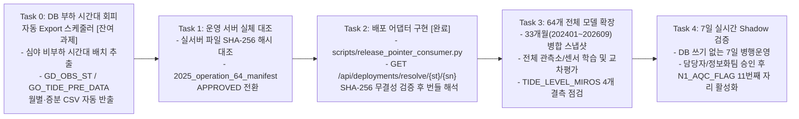

> **상위 통합 문서**: [42. 조위 AI-QC MLOps 엔진 통합 및 5대 연동 브리지](../42_AI_QC_MLOPS_ENGINE_INTEGRATION.md)  
> **문서 세트 목차**: [00 개요](00_OVERVIEW_AND_INDEX.md) · [01 아키텍처·1:1 비교](01_ARCHITECTURE_AND_FEATURES.md) · [02 웹 운영 가이드](02_USER_WEB_OPERATION_GUIDE.md) · [03 Local QC·임계값 평가](03_LOCAL_QC_SIMULATOR_AND_EVALUATION.md) · [04 한계·상용화 로드맵](04_LIMITATIONS_AND_PRODUCTION_ROADMAP.md) · [05 MLOps 거버넌스](05_MLOPS_GOVERNANCE_AND_POLICY.md)

---

# 현재 시스템의 한계점 및 운영 적용을 위한 잔여 과제 (`04_LIMITATIONS_AND_PRODUCTION_ROADMAP.md`)

2026-10-20 현재 비교는 Champion 2025와 후보 두 LSTM으로 통일하며, 과거 추가 모델 결과는 원본을 보존한 채 조회에서 제외한다. 새 Ridge 자산을 만들지 않는 처리와 네 학습 단계 표시는 [01 문서](01_ARCHITECTURE_AND_FEATURES.md)를 따른다. 임계값·승격 검사와 실제 운영 상태는 유지한다.

이전 v2의 완료 범위와 제한도 본 문서 세트(`01~04`)에 통합되어 있다. 이전의 “접근 위반 근본 해결” 설명은 이번 NVIDIA DXCore 예외의 원인으로 입증되지 않아 철회했다. 별도 CPU 환경에서 같은 실패 조건을 연속 3회 검증했다. 전체 월별 순위는 집계 작업이 완료된 뒤 확정되며, 운영 DB 접속과 운영 배포는 이번 작업 범위에 포함하지 않는다.

2026-10-20 Local QC Simulator와 운영 호환 임계값·두 계층 평가의 현재 기준은 [03 문서](03_LOCAL_QC_SIMULATOR_AND_EVALUATION.md)에 정리했다. 새 7개 재생은 모두 정상 종료했고, 기능 구현 당시 강제 v2 전체 시험 268개는 제어 환경에서 259개 통과·9개 건너뜀, CPU 환경에서 236개 통과·32개 건너뜀이며 실패·오류는 없었다. 이후 커밋 전 검토에서 월 원스톱 평가의 준비용 선택값 자동 변경으로 완료 표시가 남지 않던 화면 처리를 보완하고 성공·실패 회귀시험을 추가했다. 최종 전송 검증은 [42_AI_QC_MLOPS_ENGINE_INTEGRATION.md](../42_AI_QC_MLOPS_ENGINE_INTEGRATION.md)를 따른다. 이전의 두 모듈 37개 검증과 과거 7개 결과는 이전 시점의 기록이다. 아래 제약은 별도로 남아 있다.

- 작업기·CLI는 TEST·ALL만 실행한다. UI에는 VALIDATION도 보이고 API 입력 검사는 TRAIN·VALIDATION까지 받으므로 지원 범위 밖 요청은 작업 실패가 될 수 있다.
- 작업기는 세 단계 진행 콜백을 제공하지만 dashboard가 이를 전달하지 않아 화면은 시작·실행·종료 상태 중심으로 갱신한다. series 조회 API는 있지만 Step 6 표가 이를 호출하는 별도 시계열 차트는 연결되지 않았다.
- QC 자식 프로세스의 stdout을 끝까지 읽은 다음 `communicate(timeout=3600)`를 호출하므로, 자식이 멈추거나 별도 stderr 파이프가 차면 제한시간이 전체 대기를 끝내지 못하고 작업 잠금이 계속 유지될 수 있다. 이번 전송 검토에서 소스로 확인했으며 실제 멈춤을 재현하거나 실행 로직을 수정하지 않았다.
- **2026-10-20 해소 — 후보 선택 변경 뒤 이전 결과가 섞이던 문제:** 후보·평가 스냅샷·범위를 바꾸면 이전 차트와 QC 표를 즉시 비우고 요청 세대를 바꾼다. 후보 선택을 비우거나 시뮬레이션이 없는 후보로 바꾼 경우에도 늦은 응답을 버리며, 평가·시뮬레이션 작업이 끝나도 사용자가 새로 고른 후보나 기록을 덮어쓰지 않는다. 응답을 늦춰 후보 A→B 전환·선택 해제·스냅샷 변경·작업 완료 순서를 검사한 시험을 포함해 `tests/test_ui_v2_behavior.py`의 19개가 `mlflow_trial_env`와 `python3_10_cpu_env`에서 각각 모두 통과했다. 이는 해당 UI 시험의 결과이며 저장소 전체 회귀시험의 최종 결과를 뜻하지 않는다. 이번 평가·배포 기준 변경은 [운영 호환 임계값 전략 계획](03_LOCAL_QC_SIMULATOR_AND_EVALUATION.md)을 따른다.
- 현재 정책·번들·배포 소비값·전체 평가 기간이 맞는 QC 결과가 없으면 실제 승격을 차단한다. 과거 정책이나 일부 시간만 재생한 기록은 조회할 수 있지만 현재 전체 평가의 근거로 쓰지 않는다. Tier 1은 정상 G 예측 MAE·RMSE·R²와 실제 B가 있는 공통 창의 잔차 F1·사건 재현율을 검사하며, Tier 2는 online·consolidated 각각 FP·FN 비악화를 요구한다.
- 새 7개 벤치마크는 `20261020T043018Z` ID로 실제 다시 재생했다. 모델·scaler는 재학습하지 않았으며 이전 `20261020T012055Z` 결과는 보존했다. 이는 로컬 원시 자료 재생이며 운영 서버 병행 검증은 아니다. 외부 월 3개는 준비 시간 180분의 실제 OBS·PRD가 없고, 인천 두 결과와 묵호 외부 월은 B=0이다. 후포 외부 월도 B가 2분뿐이다. 준비 자료가 없는 구간을 충분히 준비된 상태라고 표시하거나 B=0을 이상 탐지 검증 완료로 해석하지 않는다.
- Tier 1의 공통 입력창과 Tier 2 전체 재생은 평가 분모가 다르다. 사후 과거 변경을 최초 탐지로 해석하거나 원시 결측 감소로 표시하지 않는다. 인천 TEST 한 구간은 새 기준을 통과하지만 같은 후보의 현재 외부 202601 평가는 FP 11→13으로 차단된다. 후포 계절 TEST는 운영 FP·FN 검사를 통과해도 정상 예측 RMSE·R² 악화로 차단된다. 나머지 구간도 각 원인을 [03 문서](03_LOCAL_QC_SIMULATOR_AND_EVALUATION.md)에 기록했다. 이번 작업에서 실제 승격·운영 배포를 수행하지 않았다.

작성·갱신일: 2026-10-22 
관련 인덱스: [00_OVERVIEW_AND_INDEX.md](00_OVERVIEW_AND_INDEX.md)

---

### 1. 코드 및 아키텍처 한계점 해소 현황 및 잔여 구조적 제약 (Code & Architectural Status)

아래 1.1~1.4절은 2026-10-16 당시의 구현 설명이다. 당시 네 모델 비교에 필요했던 Ridge 처리도 이력으로 남긴다. 특히 1.3절의 “근본 해결” 설명은 문서 첫머리에 적은 대로 철회했으며, 실제 DXCore 예외와 별도 CPU 검증은 `05 문서`를 따른다. 현재 후보 비교에는 Ridge 계산이나 파일이 필요하지 않다.

### 1.1 [해소 완료 · RESOLVED] 모든 변경·평가·재생 API 엔드포인트의 `LOCK` 동기화
- **해결 내용 및 코드 근거**:
  - 비동기 작업(`POST /api/jobs/{kind}`, `POST /api/candidates/train`, `POST /api/data/analyze`)뿐 아니라 동기 엔드포인트 5종(`POST /api/candidates/{run_id}/evaluate`, `POST /api/candidates/{run_id}/replay`, `POST /api/candidates/{run_id}/promote`, `POST /api/deployments/rollback`, `POST /api/data/snapshots`) 및 원클릭 스냅샷 준비 엔드포인트(`POST /api/pipeline/quick_prepare`) 모두에 `LOCK.acquire(blocking=False)`(경합 시 HTTP `409 Conflict` 반환 및 `finally: LOCK.release()`)를 적용했습니다([local_dashboard.py](../../ocean-ai-platform/mlops-qc-engine/scripts/local_dashboard.py), [dataset_routes.py](../../ocean-ai-platform/mlops-qc-engine/scripts/dataset_routes.py)).

### 1.2 [해소 완료 · RESOLVED] Depth 1 운영 현황 · Step 1~4 위저드 UI · 드래그 연·월 칩 선택기 · 시험 월 추천 · 이상치 오버레이 · 독립 롤백 UX
- **해결 내용 및 코드 근거**:
  - **Depth 1 운영 현황 패널 (`#depth1OperatingPanel`, `#operatingStationCards`) 및 센서 카드 (`#quickSensorCards`, `#dataSensorCards`) ([ui/dashboard.html](../../ocean-ai-platform/mlops-qc-engine/ui/dashboard.html), [ui/data_preview.html](../../ocean-ai-platform/mlops-qc-engine/ui/data_preview.html))**:
    - 49개 관측소·64개 조위 센서의 한글 관측소명(`friendly_station_label`)·센서 설명(`friendly_sensor_label`) 카드를 제공하고, Depth 1 또는 Step 1 선택 시 `syncStationSensorToStep2And3` 및 `updateTrainEvalSnapshotOptions`로 Step 2·Step 3 드롭다운이 자동 동기화·필터링됩니다.
  - **Step 1~4 단계별 위저드(`#wizardStepper`), 2023~2026 연·월 클릭·드래그 그리드 (`#quickMonthGrid`, `#dataMonthChipGrid`, `#quickToggleMonthMode`, `#dataToggleMonthMode`), 시험 월 추천 (`GET /api/pipeline/recommend_test_months`, `#testMonthRecommendBox`)**:
    - 메인 화면(`/`)과 상세 화면(`/data`) 양쪽 모두에서 마우스 드래그 연속 연·월 선택 및 비연속 개별 월 토글(`selected_yms`)로 시작일·종료일 설정과 월별 관측/예측 CSV(`data_YYYYMM.csv`, `GO_TIDE_PRE_DATA_YYYYMM.csv`) 배열 매칭(및 `#btnQuickClearFiles`, `#clearMultiPathsBtn` 초기화)이 동시에 수행됩니다.
    - `/data`에서 저장된 여러 검사 기록(`dataset_ids`)을 체크박스(`#multiDatasetCheckboxes`, `.ds-merge-check`)로 선택하고 분할 비율(`#mergedSplitRatios`)을 지정하여 단일 통합 `Ocean-AI` Parquet 스냅샷으로 병합 생성하는 `#buildMergedSnapshotBtn`을 제공합니다.
  - **Step 3 이상치 오버레이 시계열 차트 (`#candChartArea`, `#candChartAnomalyLegend`, `#candChartAnomalySummary`, `.candidate-only-caught`) 및 독립 롤백 UX (`#rollbackTargetSelect`, `.btn-row-rollback`)**:
    - 시계열 예측 곡선 위에 이상치 시점(붉은 원 `#e03131`), 두 모델 모두 탐지한 시점(흰색 테두리 빨간 원 `fill="#e03131", stroke="#ffffff"`), 신규 후보 단독 탐지 성공 시점(초록 외곽 링 `.candidate-only-caught`, `#12b886`), 후보 미탐지 시점(주황 테두리 흰 원 `#f08c00`)을 오버레이하고, `#candRunSelect` 선택과 무관하게 즉시 롤백할 수 있습니다.

### 1.3 [2026-10-16 당시 설명 · 근본 해결 주장은 철회] 1년치(524,845행) 대용량 후보 학습 `0xC0000005` 네이티브 크래시 근본 해결 및 타 연도 교차 평가
- **해결 내용 및 코드 근거**:
  - **배정밀도(`np.float64`) Ridge 적합 및 순환 GC 충돌 차단 ([scripts/candidate_training_worker.py](../../ocean-ai-platform/mlops-qc-engine/scripts/candidate_training_worker.py), [scripts/ocean_ai_snapshot.py](../../ocean-ai-platform/mlops-qc-engine/scripts/ocean_ai_snapshot.py))**:
    - 367,045개 `TRAIN` 윈도우에서 `float32` `Ridge` 정규방정식 `X.T @ X` 단정밀도 누적 오버플로우(`rcond=3.94e-8`)를 막기 위해 `fit_ridge_baseline()`에서 연속된 `np.float64` 배열로 적합하도록 수정했습니다.
    - `model.fit` 입력 배열(`x_train_shuf`, `y_train_shuf`, `x_val_contig`, `y_val_contig`)을 연속 `np.float32`로 고정하고, `predict_keras_model`을 16,384윈도우 단위로 분할 추론하며, 파이썬 참조가 남아있는 상태에서 `tf.keras.backend.clear_session()`을 호출해 발생하던 순환 GC 충돌을 제거(`gc.disable()` 포함)했습니다.
    - `extract_labeled_evaluation_windows`의 524,845행 `iterrows()` 순회를 벡터화(`.tolist()` + `zip`)하고 이상치 0건 시 조기 반환하도록 개선했습니다.
  - **타 연도·기간 스냅샷 교차 평가 (`POST /api/candidates/{run_id}/evaluate`, `evaluate_bundle_on_snapshot`)**:
    - 2025년 스냅샷으로 학습한 모델을 2026년 스냅샷 등 임의의 동일 관측소·센서 스냅샷(`eval_snapshot_id`, `eval_scope="ALL"|"TEST"|"AUTO"`)으로 즉시 교차 평가하고 `comparison_train_test.json` 백업으로 언제든 복원할 수 있습니다.

### 1.4 [해소 완료 · RESOLVED] 외부 반출 CSV 디스크 경로의 환경변수 설정 분리
- **해결 내용 및 코드 근거**:
  - [scripts/workspace_paths.py](../../ocean-ai-platform/mlops-qc-engine/scripts/workspace_paths.py)에 `resolve_export_roots()` 및 `resolve_additional_data_roots()`를 구현하여 `AI_QC_DATA_WORKSPACE`뿐 아니라 `AI_QC_EXPORT_ROOT`, `AI_QC_TIDE_EXPORT_ROOT`, `AI_QC_TIDE_EXPORT_UTF8_ROOT`, `AI_QC_EXTRA_DATA_ROOTS`(`os.pathsep` 구분 다중 경로) 환경변수를 통해 타 서버나 컨테이너 환경에서도 소스 수정 없이 모든 데이터 루트를 설정할 수 있습니다.

### 1.5 [잔여 구조적 제약] 인메모리 타임스탬프 교집합 적재 및 조위(`TIDE_LEVEL`, 2피처) 중심 고정 스키마
- **현상 및 근거**:
  - **인메모리 딕셔너리 적재**: [scripts/dataset_preview.py](../../ocean-ai-platform/mlops-qc-engine/scripts/dataset_preview.py)의 `read_values` 및 `_read_multiple_values`는 CSV는 스트리밍으로 읽지만, 필터링된 유효 시각의 `(OBS, PRD)` 값을 파이썬 `dict`에 적재한 뒤 교집합(`obs.keys() & prd.keys()`)을 구합니다. 단일 관측소의 다년치(1~3년치 52만~145만 분)는 메모리 내 처리가 가능하나, 전 관측소 동시 적재 시 메모리 사용량이 증가합니다.
  - **조위 2피처 고정 스키마**: [scripts/ocean_ai_snapshot.py](../../ocean-ai-platform/mlops-qc-engine/scripts/ocean_ai_snapshot.py)에서 스냅샷 계약이 `domain="fixed_station"`, `item_id="tide"`, `target_variable="TIDE_LEVEL"`, `feature_columns=["OBS", "PRD"]`로 고정되어 있습니다. 보관 폴더 인벤토리([manifests/2025_training_archive_inventory.json](../../ocean-ai-platform/mlops-qc-engine/manifests/2025_training_archive_inventory.json))에 존재하는 수온(`WATER_TEMP`, 5개), 염분(`SALINITY`, 3개) 등 비운영 타 항목이나 기압·풍속 등 외생 변수(Exogenous Features)를 추가하려면 스키마 및 스케일러 차원(`n_features_in_ == 2` 고정 검사, [candidate_training_worker.py](../../ocean-ai-platform/mlops-qc-engine/scripts/candidate_training_worker.py)) 확장이 필요합니다.

---

## 2. 데이터 및 모델 검증 상의 분석 결과 (회귀 오차 + 100점 만점 F1-Score 이상치 분류 + 타 연도 교차 평가)

### 2.1 과거 로그 재생 비교(`20261007T004328Z_fb946b3984`)의 범위 한계 및 불일치 모델
`reports/local_runs/20261007T004328Z_fb946b3984/results.json`에 기록된 64개 운영 모델에 대한 과거 상세 로그(946개 파일) 재생 비교 결과는 다음과 같습니다:

| 구분 | 모델 수 | 상세 내역 및 원인 |
| :--- | :---: | :--- |
| **PASS (`<= 0.01 cm`)** | **55개** | 비교 시점 전체에서 당시 로그의 `predicted_obs`와 재실행 예측값의 최대 차이가 `0.01 cm` 이내로 일치 |
| **MISMATCH (`> 0.01 cm` 실패)** | **5개** | 기준(`0.01 cm`)을 초과하는 예측 차이가 확인되어 보호 원칙에 따라 수정 없이 **최종 실패(`FAILED`)**로 기록: - `DT_0004` (`TIDE_LEVEL_LASER_1`, 남해): 최대 차이 `0.297209 cm` (비교 16개, `debug_logs/debug_log_남해_20260822.csv`) - `DT_0004` (`TIDE_LEVEL_LASER`, 남해): 최대 차이 `0.228546 cm` (비교 16개, `debug_logs/debug_log_남해_20260822.csv`) - `DT_0005` (`TIDE_LEVEL_LASER_1`, 남해): 최대 차이 `0.132372 cm` (비교 16개, `debug_logs/debug_log_남해_20260822.csv`) - `DT_0005` (`TIDE_LEVEL_VEGA`, 남해): 최대 차이 `0.030107 cm` (비교 16개, `debug_logs/debug_log_남해_20260822.csv`) - `DT_0010` (`TIDE_LEVEL_VEGA`, 남해): 최대 차이 **`1.239479 cm`** (비교 16개, `debug_logs/debug_log_남해_20260716.csv`) |
| **NO_ELIGIBLE_NORMAL_WINDOWS (비교 제외)** | **4개** | `DT_0041`, `DT_0043`, `DT_0050`, `DT_0057`의 `TIDE_LEVEL_MIROS` 센서 4개는 반입된 상세 로그의 모든 행이 결측(`final_flag == 9`)이고 `predicted_obs`가 존재하지 않아 비교 대상 입력창 자체가 0개임 |
| **합계** | **64개** | 비교 가능 60개 모델(총 **1,140개 시점**) 평가 완료 (`complete_64_coverage: False`) |

> [!IMPORTANT]
> **재생 시험의 구조적 한계 ([offline_model_suite.py:192](../../ocean-ai-platform/mlops-qc-engine/scripts/offline_model_suite.py))**:  
> 이 재생 시험은 직전 4개 시점의 `final_flag`가 모두 정상(`"1"`)이고 1분 간격으로 연속된 구간만 발췌하여 순수 LSTM 추론값만 대조한 **제한된 오프라인 시험**입니다. 운영 코드가 수행하는 **과거 시점 판정 소급 수정, 결측 시 잔차 보간(`create_synthetic_gap_point`), Sneaky Drift / Flat Value 복합 판정, 피클 상태 파일(`state_*.pkl`) 전이, 그리고 실제 운영 서버에서의 7일 실시간 병행운영(Shadow Operation)을 재현한 것이 아닙니다.**

### 2.2 과거 후보 모델 네 모델 비교 결과 (2026-10-14~16) (`reports/candidate_runs/` — 회귀 MAE/RMSE 및 100점 만점 이상치 분류 F1-Score)

아래 표는 2026-10-14~16 당시 네 모델로 실행한 5건의 지표를 그대로 보존한다. 제어 이상치를 포함한 과거 평가와 실제 B 평가는 표의 평가 모드로 구분하며, 현재 두 LSTM 평가나 실제 운영 검증 결과로 다시 해석하지 않는다:

| 실행 ID (`run_id`) | 관측소 / 센서 (학습 · 평가 스냅샷) | 평가 모드 (정상 G / 이상치 B 창 수) | 모델별 MAE (RMSE) | 모델별 이상치 분류 **F1-Score (100점 만점)** (`Precision / Recall`) | 핵심 분석 및 시사점 |
| :--- | :--- | :--- | :--- | :--- | :--- |
| **``20261016T030628Z_5f28e86e``** (MLflow `v4`, **1년 학습 + 2026 교차평가**) | 묵호 `DT_0006` `TIDE_LEVEL_LASER` - **학습**: `20261016T100944_5f81cca7` (**2025년 1년 전체 524,845행**) - **평가**: `20261016T115153_82ef6d9d` (**2026-01 전체 44,621창**) | `NATURAL_G_PLUS_CONTROLLED_SPIKE_BENCHMARK` **[2026-01 ALL 교차평가]** 정상 `'G'` **35,696창** + 제어 이상치 **8,925창** (총 **44,621창**, 후보 임계 `7.60 cm`) | **[2026-01 교차평가]** - `champion_2025`: **`1.259685 cm`** (`1.657791 cm`) - `ridge`: `1.297784 cm` (`1.736975 cm`) - `candidate`: `1.316383 cm` (`1.751253 cm`) - `persistence`: `1.363573 cm` (`1.863739 cm`) *(2025 TEST 78,623창: `candidate` MAE `1.153883 cm`)* | **[2026-01 교차평가]** - **`candidate`: `99.37점` (1위)** (`99.20% / 99.55%`) - `ridge`: **`99.34점`** (`98.98% / 99.70%`) - `champion_2025`: **`99.11점`** (`99.94% / 98.30%`) - `persistence`: **`98.02점`** (`99.92% / 96.19%`) *(2025 TEST: `candidate` **`99.57점`** vs `champion_2025` `99.29점`)* | 2025년 1년 전체(524,845행)로 학습한 `candidate` 모델이 **2025년 자체 TEST(`99.57점` vs `99.29점`)와 2026년 1월 미학습 미래 데이터 교차 평가(`99.37점` vs `99.11점`) 양쪽 모두에서 `champion_2025`보다 높은 이상치 탐지 F1-Score를 달성**함. |
| **``20261015T085043Z_d6695234``** (MLflow `v3`) | 흑산도 `DT_0035` `TIDE_LEVEL_LASER_1` (`20261015T175043_97b6c59a`, 2024-01) | **`NATURAL_MQC_FLAG_G_AND_B`** 정상 `'G'` **5,975창** + 실제 `'B'` **3,764창** (총 **9,739창**, 후보 임계 `7.66 cm`) | - `champion_2025`: **`0.516678 cm`** (`0.665620 cm`) - `ridge`: `0.542066 cm` (`0.694152 cm`) - `persistence`: `0.775732 cm` (`1.067982 cm`) - `candidate`: `1.200871 cm` (`1.473387 cm`) | - `champion_2025`: **`100.0점`** (`100.0% / 100.0%`, TP=3764, FP=0, FN=0) - `ridge`: **`100.0점`** (`100.0% / 100.0%`, TP=3764, FP=0, FN=0) - `persistence`: **`99.21점`** (`100.0% / 98.43%`, TP=3705, FP=0, FN=59) - `candidate`: **`98.80점`** (`100.0% / 97.64%`, TP=3675, FP=0, FN=89) | 실제 KHOA 수동 품질검사(`MQC_FLAG == 'B'`, 303.0cm 센서 동결 결함 등 4,778분) 데이터셋에서 **`champion_2025`와 `ridge`가 100.0점 만점 F1-Score로 이상치를 완벽히 분류**함. 1개월 데이터로 학습한 `candidate`도 오경보(FP=0) 없이 **98.80점** 달성. |
| **``20261014T084211Z_af81e555``** (MLflow `v5`, Champion) | 인천 `DT_0001` `TIDE_LEVEL_VEGA` (`20261014T173100_20240101`, 2024-01) | `NATURAL_G_PLUS_CONTROLLED_SPIKE_BENCHMARK` 정상 `'G'` **5,353창** + 제어 이상치 **1,339창** (총 **6,692창**, 후보 임계 `3.90 cm`) | - `ridge`: **`0.384425 cm`** (`0.489271 cm`) - `candidate`: **`0.701027 cm`** (`0.869231 cm`) - `champion_2025`: `0.715974 cm` (`0.881412 cm`) - `persistence`: `1.916169 cm` (`2.158782 cm`) | - `candidate`: **`100.0점`** (`100.0% / 100.0%`, TP=1339, FP=0, FN=0) - `champion_2025`: **`99.96점`** (`100.0% / 99.93%`, TP=1338, FP=0, FN=1) - `ridge`: **`99.67점`** (`99.33% / 100.0%`, TP=1339, FP=9, FN=0) - `persistence`: **`79.37점`** (`100.0% / 65.80%`, TP=881, FP=0, FN=458) | 신규 `candidate` LSTM이 기존 `champion_2025` 대비 회귀 오차(`0.7010 cm` vs `0.7160 cm`)와 이상치 분류 F1-Score(`100.0점` vs `99.96점`) 모두 개선. |
| **``20261015T065312Z_7f8a0746``** (MLflow `v3`, Champion) | 묵호 `DT_0006` `TIDE_LEVEL_LASER` (`20261015T155229_d53ac5b7`, 2025-01) | `NATURAL_G_PLUS_CONTROLLED_SPIKE_BENCHMARK` 정상 `'G'` **5,342창** + 제어 이상치 **1,336창** (총 **6,678창**, 후보 임계 `5.93 cm`) | - `ridge`: **`1.398536 cm`** (`1.766485 cm`) - `champion_2025`: `1.408267 cm` (`1.791634 cm`) - `persistence`: `1.419437 cm` (`1.854267 cm`) - `candidate`: `1.488253 cm` (`1.885095 cm`) | - `persistence`: **`99.66점`** (`99.40% / 99.93%`, TP=1335, FP=8, FN=1) - `ridge`: **`99.63점`** (`99.26% / 100.0%`, TP=1336, FP=10, FN=0) - `champion_2025`: **`99.25점`** (`100.0% / 98.50%`, TP=1316, FP=0, FN=20) - `candidate`: **`99.22점`** (`98.45% / 100.0%`, TP=1336, FP=21, FN=0) | 동해(묵호) 조위에서 4개 모델 모두 99점 이상 F1-Score를 달성하며, `candidate`는 100.0% Recall(미탐지 FN=0)을 기록함. |
| **``20261014T084240Z_f48f7fdf``** (MLflow `v6`, Rollback) | 인천 `DT_0001` `TIDE_LEVEL_VEGA` (`20261014T173000_20210601`, 2021-06) | `NATURAL_G_PLUS_CONTROLLED_SPIKE_BENCHMARK` 정상 `'G'` **5,156창** + 제어 이상치 **1,290창** (총 **6,446창**, 후보 임계 `8.61 cm`) | - `ridge`: **`1.025761 cm`** (`1.334199 cm`) - `champion_2025`: **`1.171423 cm`** (`1.468299 cm`) - `candidate`: `1.353869 cm` (`1.639176 cm`) - `persistence`: `2.073999 cm` (`2.650643 cm`) | - `ridge`: **`99.96점`** (`100.0% / 99.92%`, TP=1289, FP=0, FN=1) - `champion_2025`: **`99.69점`** (`99.38% / 100.0%`, TP=1290, FP=8, FN=0) - `candidate`: **`99.22점`** (`100.0% / 98.45%`, TP=1270, FP=0, FN=20) - `persistence`: **`96.18점`** (`100.0% / 92.64%`, TP=1195, FP=0, FN=95) | 2021년 6월 단일 1개월 학습만으로는 3년치(2020~2022)로 학습된 `champion_2025`보다 회귀 오차가 높음(다중 월 병합 스냅샷 학습 필요성 확인). |

---

## 3. 레거시 운영 코드의 잠재 결함 (`reports/legacy_configuration_inventory.json` 근거)

원본 불변 원칙에 따라 수정하지 않고 보존 중인 `2026년_AI_품질처리_데이터백업` 내 레거시 운영 스크립트에는 향후 운영 고도화 시 반드시 해결해야 할 다음 결함들이 확인되어 있습니다:

| 결함 유형 | 대상 레거시 파일 및 위치 | 상세 내용 및 위험도 |
| :--- | :--- | :--- |
| **DB 접속정보 평문 하드코딩** | `AI_QC_east_sea.py`, `AI_QC_west_sea.py`, `AI_QC_south_sea.py` (`db_engine`, `init_oracle_client` 등) | 운영 Oracle DB 계정·비밀번호·DSN이 소스코드 내부에 평문으로 하드코딩되어 있음 (`legacy_configuration_inventory.json`에서는 `REDACTED` 처리). |
| **개발자 개인 PC 절대경로 하드코딩** | `모델학습/LSTM_Training_GPU.py`, `calculate_residual_std_thresholds.py`, `AI_QC_*_sea.py` | 과거 개발자 PC 경로(`C:/Users/ust21/...`, `D:/...`)가 하드코딩되어 있어 실행 위치 변경 시 즉시 `FileNotFoundError` 발생. |
| **예외 처리 블록의 정의되지 않은 변수 참조 (`NameError`)** | `NEAR_TIME_QC_no_update_v3.py:229` | 예외 블록 또는 로깅 구문에서 바인딩되지 않은 예외 변수 `e`를 참조하여 해당 분기 진입 시 `NameError: name 'e' is not defined`로 프로세스가 비정상 종료될 위험. |
| **`qc_flag` `None` 문자열 결합 위험 (`TypeError`)** | `AI_QC_south_sea_no_update.py:134` (및 해역별 플래그 갱신 함수) | DB 또는 입력에서 `N1_AQC_FLAG`가 `None`이거나 길이가 11자 미만일 때 문자열 슬라이싱/결합 시 `TypeError` 가능성. |
| **`no_update` 본과 이전 반입본 간 소스 해시 차이** | `운영코드/AI_anomaly_detection/AI_QC_{east,west,south}_sea_no_update.py` | `소스코드/AI QC/` 아래의 동명 파일과 SHA-256 해시가 상이하며, `update_n1_aqc_flag` 호출부가 주석 처리되어 있음 (`00_OVERVIEW_AND_INDEX.md`). |

---

## 4. 실제 운영 서버(Production) 적용을 위해 남아있는 작업 로드맵

현재 로컬 시험실(`ai-qc-mlops`)에서 검증된 Step 1~4 MLOps 파이프라인을 실제 KHOA 운영 서버에 적용하기 위한 **5단계 로드맵**(운영 DB 부하 회피 자동 Export 과제 포함) 및 현재 달성 상태는 다음과 같습니다.

### 단계별 세부 실행 과제

| 단계 | 상태 | 핵심 과제 | 완료 조건 (Acceptance Criteria) |
| :--- | :---: | :--- | :--- |
| **Task 0: 운영 DB(`GD_OBS_ST`, `GO_TIDE_PRE_DATA`) 부하 시간대 회피 자동 Export 스케줄러 구현** | **향후 구현 과제 (`PLANNED`)** | - 실시간 운영 DB의 주간/정각 트랜잭션 부하 시간대(Peak Time)를 피하여 **심야·새벽 비부하 시간대(Off-Peak Window, 예: 02:00~04:00)**에 Read-Only 배치 쿼리로 `GD_OBS_ST`(관측값 + `MQC_FLAG`) 및 `GO_TIDE_PRE_DATA`(예측조위)를 월별·일자별 증분 CSV(`data_YYYYMM.csv`, `GO_TIDE_PRE_DATA_YYYYMM.csv`)로 자동 반출(`AI_QC_EXPORT_ROOT`, `AI_QC_TIDE_EXPORT_UTF8_ROOT`)하는 스케줄러 모듈 구현 - 쿼리 타임아웃, 청크 단위 페이징 조회, DB CPU/세션 부하 임계치 초과 시 자동 일시 중지(Backoff) 및 SHA-256 반출 매니페스트 자동 기록 포함 | 운영 DB 부하 영향 0% 기준 충족, 비부하 시간대 자동 Export 데몬/크론 잡 검증 및 Step 1 카탈로그(`GET /api/data/catalog`) 자동 연동 확인 |
| **Task 1: 실제 운영 서버 해시 대조 및 기준선 승인** | **대기 (운영 서버 접근 필요)** | - 실제 운영 서버에서 실행 중인 프로세스·스케줄러·가상환경·`mappingBySea.csv`·64개 모델 산출물(192개 파일)의 SHA-256 해시를 추출하여 로컬 백업본과 대조 - [manifests/2025_operation_64_manifest.json](../../ocean-ai-platform/mlops-qc-engine/manifests/2025_operation_64_manifest.json)의 `evidence_level`을 `LOCAL_BACKUP_VERIFIED` → `LIVE_RUNTIME_CONFIRMED`로, `approval.status`를 `DRAFT_PENDING_LIVE_HASH_CONFIRMATION` → `APPROVED`로 전환 | 운영 서버와 로컬 기준선 매니페스트 간 64개 모델 및 소스 해시 100% 일치 확인서 확보 |
| **Task 2: 운영 추론기용 배포 어댑터(Release Pointer Consumer) 구현** | **구현·검증 완료 (`COMPLETED`)** | - 원본 레거시 소스를 수정하지 않고 외부에서 [manifests/active_release_pointer.json](../../ocean-ai-platform/mlops-qc-engine/manifests/active_release_pointer.json)과 `manifests/releases/REL_*.json`을 읽어 관측소·센서별 승인된 모델·스케일러·임계값 경로와 SHA-256을 검증 후 반환하는 [scripts/release_pointer_consumer.py](../../ocean-ai-platform/mlops-qc-engine/scripts/release_pointer_consumer.py) 및 `GET /api/deployments/resolve/{station}/{sensor}` 엔드포인트 구현 완료 | 승격(`PROMOTED_OVERRIDE`) 및 기본(`BASELINE_2025`) 모델 모두에서 파일 덮어쓰기 없이 포인터 전환만으로 추론 번들이 즉시 전환되고 SHA-256 불일치 시 즉시 차단됨을 단위 테스트로 검증 완료 |
| **Task 3: 33개월 통합 스냅샷 구축 및 64개 전체 모델 확장** | **도구·1년치 학습·타 연도 교차평가 검증 완료 / 전수 확장 가능** | - `/`, `/data` 연·월 칩 선택기, 다중 CSV(`observation_paths`, `prediction_paths`)·다중 데이터셋(`dataset_ids`) 병합 UI, 1년치(524,845행) 무중단 학습 및 2025→2026 교차 평가(`20261016T030628Z_5f28e86e`) 검증 완료 - 향후 64개 전체 관측소·센서 조합에 대해 33개월(`202401`~`202609`) 병합 스냅샷(`meets_draft_365_day_volume: True`) 생성 및 후보 학습·교차 평가 수행 | 64개 전체 모델에 대한 365일 이상 유효량 스냅샷 확보 및 Champion 대비 회귀·분류 성능 검증 보고서 완성 |
| **Task 4: 7일 실시간 Shadow 병행운영 및 운영 DB 반영 승인** | **대기 (운영 서버 접근 필요)** | - 운영 서버에서 DB `UPDATE` 없이(`no_update` 모드) 7일간 실시간 스트림에 대해 기존 모델과 신규 Champion 모델을 병행 실행(Shadow Mode)하여 판정 일치율·지연시간·메모리 안정성 검증 - 담당자 및 정보화팀 최종 승인 후 `N1_AQC_FLAG` 11번째 자리 DB 갱신 활성화 여부 결정 | 7일 무중단 Shadow 운영 리포트 및 정보화팀 배포 승인 기록(`APPROVED`) 확보 |

